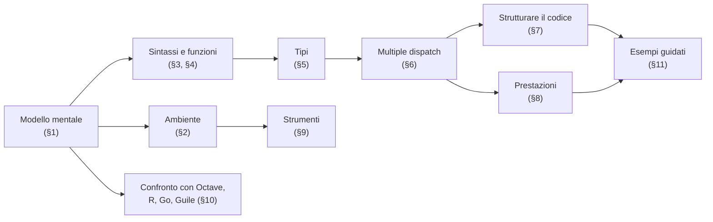
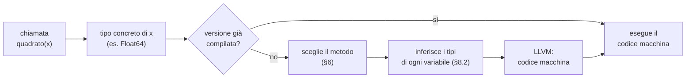
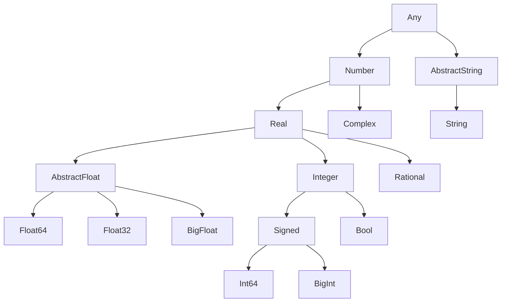
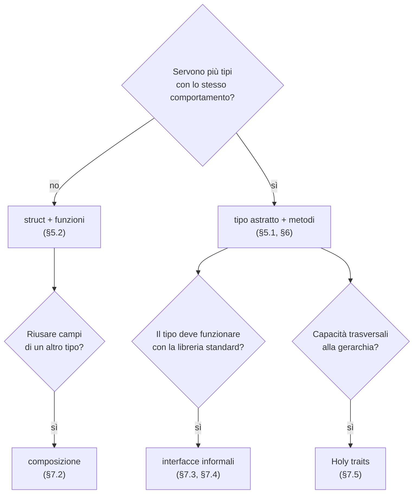
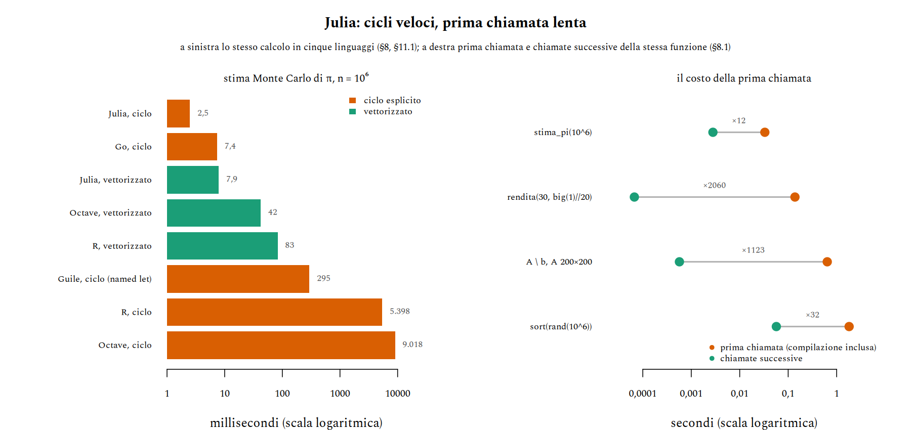
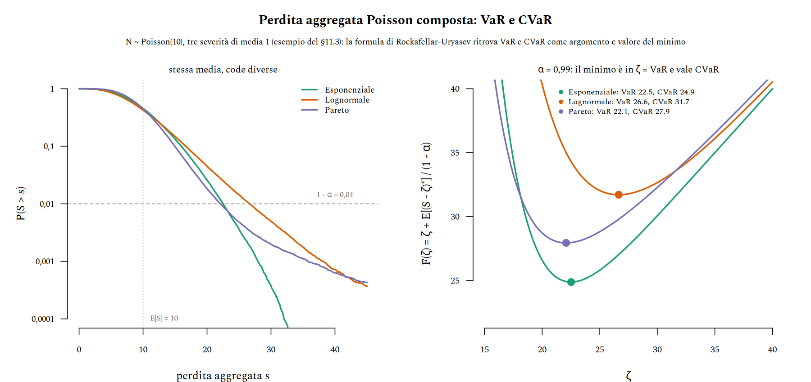

# Julia — il linguaggio in pratica

Julia è un linguaggio per il calcolo scientifico nato al MIT e reso pubblico nel 2012. Ha la sintassi concisa di R, Octave o Python, ma compila ogni funzione in codice macchina la prima volta che viene chiamata, e per questo un ciclo scritto in Julia gira alla velocità di un ciclo in C o in Go. Chi arriva da un linguaggio a oggetti tende a cercare le classi, che in Julia non ci sono; chi arriva da R o Octave tende a vettorizzare tutto, cosa che in Julia non serve. In entrambi i casi il codice funziona, ma non sfrutta il linguaggio.

Questa nota parte dal modello mentale del [§1](#1-il-modello-mentale): una sola idea, la compilazione specializzata sui tipi, spiega quasi tutte le scelte di design. Su quella si costruiscono l'ambiente di lavoro, la sintassi, il sistema di tipi e il *multiple dispatch*, che prende il posto delle classi. Seguono i modi di strutturare un programma che cresce, le regole per scrivere codice veloce e un confronto con Octave, R, Go e Guile, già trattati in [fondamenti_octave](fondamenti_octave.md), [fondamenti_r](fondamenti_r.md), [fondamenti_go](fondamenti_go.md) e [fondamenti_guile](fondamenti_guile.md). Chiudono tre esempi guidati, una raccolta di trappole e una sezione sui limiti dello strumento.


## Cosa ci serve

- **Il vocabolario dei sistemi di tipi**: statico/dinamico, nominale/strutturale, polimorfismo parametrico, come in [teoria_tipi](../teoria_linguaggi/teoria_tipi.md). Serve dal [§1.4](#14-dove-si-colloca-tra-i-sistemi-di-tipi) in poi, e soprattutto nel [§5](#5-il-sistema-di-tipi).
- **Dispatch singolo e multiplo**: il problema "cosa succede quando due forme si scontrano", visto in [fondamenti_go_oop §6](../teoria_linguaggi/fondamenti_go_oop.md#6-multiple-dispatch-quello-che-go-non-ha), [fondamenti_guile_oop §6](../teoria_linguaggi/fondamenti_guile_oop.md#6-metodi-generici-e-dispatch) e [fondamenti_r_oop §5](../teoria_linguaggi/fondamenti_r_oop.md#5-s4-il-sistema-formale), è il punto di partenza del [§6](#6-multiple-dispatch).
- **Chiusure**: la distinzione tra catturare un *binding* e catturarne il valore, discussa in [teoria_chiusure §6](../teoria_linguaggi/teoria_chiusure.md#6-binding-vs-cella), serve nel [§4.4](#44-chiusure-si-cattura-il-binding).
- **Un po' di probabilità**: media, quantili e la legge dei grandi numeri, per gli esempi del [§11](#11-esempi-guidati).



> **Convenzioni.** Gli esempi sono stati verificati con Julia 1.13.1. Il risultato di un'espressione è indicato con `# =>`; i tempi, misurati su un normale portatile, contano solo come ordini di grandezza. Tutto il codice usa solo la libreria standard, tranne il [§9.4](#94-pacchetti-per-statistica-e-finanza) e la parte finale del [§11.3](#113-perdita-aggregata-var-e-cvar), che usano `Distributions`, `JuMP` e `HiGHS`.


## 1. Il modello mentale


### 1.1 Il problema dei due linguaggi

Nel calcolo scientifico si lavora spesso con due linguaggi. Si prototipa in uno ad alto livello (R, Octave, Python), comodo e interattivo ma lento nei cicli; quando il prototipo funziona, le parti critiche si riscrivono in uno a basso livello (C, C++, Fortran), veloce ma verboso. Le stesse librerie di R e Octave sono costruite così: `sum` o `A \ b` sono veloci perché sotto c'è codice compilato, e la vettorizzazione ([fondamenti_octave §2.6](fondamenti_octave.md#26-perché-vettorizzare)) è il modo di far lavorare quel codice al posto dell'interprete.

Julia nasce per eliminare questa separazione: un unico linguaggio, abbastanza espressivo per prototipare e abbastanza veloce da non dover riscrivere niente. La libreria standard di Julia è scritta quasi interamente in Julia, e un ciclo scritto dall'utente è veloce quanto una funzione predefinita. Il prezzo di questa scelta, come si vedrà, è un costo di compilazione alla prima chiamata ([§8.1](#81-la-prima-chiamata)).


### 1.2 Compilare per tipi: la specializzazione

Julia non è interpretato: ogni funzione viene compilata in codice macchina, tramite LLVM, la prima volta che viene chiamata con una certa combinazione di **tipi concreti** degli argomenti. Una funzione scritta una volta sola, senza annotazioni,

```julia
quadrato(x) = x * x
```

diventa tante versioni compilate quante sono le combinazioni di tipi con cui viene usata: `quadrato(3)` produce codice per `Int64` (moltiplicazione tra interi), `quadrato(3.0)` codice per `Float64`, `quadrato([1 2; 3 4])` codice per `Matrix{Int64}` (prodotto matriciale). Ogni versione, detta *method instance*, viene messa in cache e riusata dalle chiamate successive con gli stessi tipi.

<div markdown="1" align="center">



</div>

Il passaggio decisivo è l'**inferenza dei tipi**: noto il tipo degli argomenti, il compilatore deduce il tipo di ogni variabile locale e di ogni risultato intermedio. Se ci riesce, il codice generato è lo stesso che si otterrebbe in C, senza controlli di tipo a runtime. Se non ci riesce, deve inserire controlli e allocazioni, e il codice rallenta. Quasi tutte le regole di prestazione del [§8](#8-il-modello-di-prestazioni) si riducono a una sola: scrivere codice in cui l'inferenza riesce.


### 1.3 Funzioni, non oggetti

In Java, Python o Octave (`classdef`) i metodi appartengono alle classi: si scrive `p.norma()` e il metodo viene cercato nella classe di `p`. In Julia i metodi appartengono alle **funzioni**: si scrive `norma(p)`, e `norma` è una funzione generica che può avere molte implementazioni (metodi), una per ogni combinazione di tipi degli argomenti. I tipi definiti dall'utente contengono solo dati.

```julia
struct Punto
    x::Float64
    y::Float64
end

norma(p::Punto) = hypot(p.x, p.y)  # metodo della funzione norma, non del tipo Punto

norma(Punto(3, 4))  # => 5.0
```

È lo stesso modello di GOOPS in Guile e di S4 in R, esteso all'intero linguaggio: anche `+`, `*`, `show` o `length` sono funzioni generiche a cui chiunque può aggiungere metodi. Il [§6](#6-multiple-dispatch) lo tratta in dettaglio; per ora basta sapere che in Julia non ci sono classi, e che il loro posto è preso dalla coppia *struct* + *funzioni generiche*.


### 1.4 Dove si colloca tra i sistemi di tipi

Con il vocabolario di [teoria_tipi](../teoria_linguaggi/teoria_tipi.md), Julia è un linguaggio:

- **dinamico**: i tipi appartengono ai valori, non alle variabili, e un errore di tipo si scopre a runtime ([teoria_tipi §7](../teoria_linguaggi/teoria_tipi.md#7-statico-vs-dinamico-applicato));
- **forte**: le conversioni implicite sono poche e controllate (la *promozione* del [§5.5](#55-promozione)); `"a" + 1` è un errore, non `98` come in Octave ([fondamenti_octave §1.4](fondamenti_octave.md#14-dove-si-colloca-tra-i-sistemi-di-tipi));
- **nominale**: un tipo è sottotipo di un altro solo se lo si dichiara ([teoria_tipi §10](../teoria_linguaggi/teoria_tipi.md#10-nominale-vs-strutturale)), a differenza delle interfacce strutturali di Go;
- con **polimorfismo parametrico** (`Vector{T}`) e **ad hoc** (i metodi), combinati dal dispatch.

Il punto che sorprende è il ruolo delle annotazioni di tipo. In un linguaggio statico servono al compilatore; in Julia il compilatore conosce comunque i tipi concreti al momento della chiamata ([§1.2](#12-compilare-per-tipi-la-specializzazione)), quindi le annotazioni sugli argomenti **non rendono il codice più veloce**. Servono a due cose: scegliere quale metodo eseguire ([§6](#6-multiple-dispatch)) e documentare o restringere cosa una funzione accetta. Nei campi delle `struct`, invece, contano anche per le prestazioni ([§5.2](#52-struct-e-costruttori)).


## 2. Ambiente di lavoro

I principianti inciampano più sul flusso di lavoro che sulla sintassi: come installare, dove mettere le dipendenze, come evitare di riavviare la sessione a ogni modifica.


### 2.1 Installare e gestire le versioni

Il modo raccomandato di installare Julia è `juliaup`, un gestore di versioni simile a `rustup`. Permette di tenere più versioni affiancate e di scegliere quale usare.

```sh
curl -fsSL https://install.julialang.org | sh  # installa juliaup e l'ultima versione stabile

juliaup status        # versioni installate e quella predefinita
juliaup add lts       # aggiunge la versione long-term support
juliaup update        # aggiorna tutte le versioni installate
julia +lts            # avvia una versione specifica
```


### 2.2 La REPL e le sue modalità

La REPL di Julia ha diverse modalità, a cui si accede con un tasto all'inizio della riga e da cui si esce con il backspace:

| Tasto | Prompt         | Modalità                                         |
|-------|----------------|--------------------------------------------------|
| —     | `julia>`       | codice Julia                                     |
| `]`   | `pkg>`         | gestore dei pacchetti ([§2.3](#23-ambienti-di-progetto)) |
| `?`   | `help?>`       | documentazione di una funzione o di un tipo      |
| `;`   | `shell>`       | comandi della shell                              |

Due comodità da conoscere subito: il tasto Tab completa i nomi e trasforma le sequenze LaTeX in caratteri Unicode (`\alpha` + Tab diventa `α`, `\in` diventa `∈`), e la variabile `ans` contiene l'ultimo risultato.


### 2.3 Ambienti di progetto

Un ambiente è una cartella con due file:

- `Project.toml` elenca le dipendenze **dirette** del progetto, cioè i pacchetti che si usano con `using`;
- `Manifest.toml` registra la versione **esatta** di ogni pacchetto, dipendenze indirette comprese.

Il primo dice cosa serve, il secondo fotografa una configurazione che funziona: chi riceve il progetto con entrambi i file ottiene esattamente le stesse versioni. È lo stesso ruolo di `go.mod`/`go.sum` in Go o di `renv.lock` in R.

```julia
pkg> activate .         # usa l'ambiente nella cartella corrente (lo crea se serve)
pkg> add Distributions  # aggiunge una dipendenza e aggiorna entrambi i file
pkg> status             # dipendenze dell'ambiente attivo
pkg> instantiate        # installa esattamente quanto scritto nel Manifest
pkg> update             # aggiorna alle versioni più recenti compatibili
```

Da terminale, `julia --project=.` avvia Julia con l'ambiente della cartella corrente già attivo. Senza un ambiente esplicito, i pacchetti finiscono nell'ambiente globale (`~/.julia/environments/v1.13`): comodo per strumenti di uso generale come `Revise`, ma da evitare per le dipendenze dei progetti, che altrimenti finiscono per entrare in conflitto tra loro.


### 2.4 Revise e il ciclo di sviluppo

Riavviare Julia costa: ogni pacchetto va ricaricato e ogni funzione ricompilata ([§8.1](#81-la-prima-chiamata)). Il pacchetto `Revise` evita i riavvii: tiene d'occhio i file caricati e, quando cambiano, aggiorna le definizioni nella sessione in corso.

```julia
using Revise
includet("modello.jl")  # 't' sta per tracked: le modifiche al file vengono riapplicate
```

Il flusso di lavoro tipico è una REPL sempre aperta con `Revise` caricato, un editor accanto, e funzioni richiamate a mano dopo ogni modifica. Per i package ([§7.1](#71-moduli-e-package)) basta `using Revise` prima di `using MioPacchetto`. Fino a Julia 1.11 c'era un limite pesante: una `struct` già caricata non si poteva ridefinire, e cambiarne i campi richiedeva un riavvio. Da Julia 1.12 il linguaggio permette di ridefinire i tipi e Revise aggiorna anche quelli, ma i valori creati prima della modifica restano del tipo vecchio: dopo aver cambiato una `struct` conviene ricreare i dati che la usano.


### 2.5 Julia da terminale

Uno script si esegue con `julia script.jl`; gli argomenti della riga di comando sono nel vettore di stringhe `ARGS`. Con uno *shebang* lo script diventa un eseguibile:

```julia
#!/usr/bin/env julia
nome = isempty(ARGS) ? "mondo" : ARGS[1]
println("ciao $nome")
```

```sh
chmod +x saluta.jl
./saluta.jl Julia                   # => ciao Julia
julia -e 'println(sqrt(2))'         # valuta un'espressione al volo
julia -t auto --project=. main.jl   # tanti thread quanti i core, ambiente locale
```

L'avvio dell'interprete richiede circa 0,2 secondi, ma la prima chiamata di ogni funzione paga la compilazione ([§8.1](#81-la-prima-chiamata)). Per script brevi lanciati spesso, il costo totale può superare quello dello stesso calcolo in Octave o R: è uno dei limiti discussi nel [§13](#13-limiti-quando-non-usarlo).


## 3. Sintassi di base

Come nel caso di Octave, questa sezione è pensata come riferimento da consultare: ogni sottosezione è autonoma.


### 3.1 Numeri e letterali

A differenza di Octave, dove ogni numero è un `double`, in Julia `1` è un intero (`Int64` su macchine a 64 bit) e `1.0` un numero in virgola mobile (`Float64`). La libreria standard include razionali esatti, interi e reali a precisione arbitraria, complessi.

```julia
typeof(1)       # => Int64
typeof(1.0)     # => Float64
1 // 3 + 1 // 6 # => 1//2         — razionale esatto
big(2)^100      # => 1267650600228229401496703205376 — BigInt
1 + 2im         # => 1 + 2im      — Complex{Int64}
7 / 2           # => 3.5          — la divisione restituisce sempre un Float64
7 ÷ 2           # => 3            — divisione intera (\div + Tab, oppure div(7, 2))
mod(-7, 2)      # => 1            — sempre con il segno del divisore
rem(-7, 2)      # => -1           — con il segno del dividendo, come % in C e Go
```

Un numero davanti a una variabile la moltiplica, come nella notazione matematica: `2x^2` significa `2 * x^2`, e `2π` è $2\pi$. È una piccola cosa, ma rende il codice numerico molto vicino alle formule.

Il confronto tra numeri in virgola mobile segue le regole IEEE, quindi l'uguaglianza esatta è raramente quella giusta. L'operatore `≈` (`\approx` + Tab, oppure `isapprox`) confronta con una tolleranza relativa:

```julia
0.1 + 0.2 == 0.3  # => false
0.1 + 0.2 ≈ 0.3   # => true
```

L'aritmetica intera, invece, non controlla l'overflow: `typemax(Int) + 1` dà silenziosamente `-9223372036854775808`. Il [§12](#12-trappole) raccoglie le conseguenze.


### 3.2 Stringhe e Unicode

Le stringhe si scrivono tra virgolette doppie, i caratteri singoli tra apici (`'a'` è un `Char`, un tipo diverso). La concatenazione si fa con `*` e la ripetizione con `^`, una scelta motivata dal fatto che la concatenazione, come il prodotto matriciale, non è commutativa. L'interpolazione usa `$`.

```julia
"ab" * "cd"                   # => "abcd"
"x"^3                         # => "xxx"
n = 2
"due più due = $(n + n)"      # => "due più due = 4"
```

Le stringhe sono codificate in UTF-8 e gli indici contano **byte**, non caratteri. Finché il testo è ASCII non si nota niente; con le lettere accentate sì:

```julia
s = "città"
length(s)  # => 5   — caratteri
sizeof(s)  # => 6   — byte: 'à' ne occupa due
s[5]       # => 'à'
s[6]       # StringIndexError: l'indice 6 cade a metà di 'à'
```

Per scorrere i caratteri si usa `for c in s` o `collect(s)`, mai un ciclo su `1:length(s)`. Anche gli identificatori possono essere Unicode: `α`, `σ²`, `Δt`, `x̄` sono nomi di variabile validi, e il codice può usare gli stessi simboli della formula che implementa. Va usato con misura: un nome che non si sa digitare è un nome che altri non sapranno cercare.


### 3.3 Array: costruire e indicizzare

La sintassi è quella di Octave: lo spazio separa le colonne, il punto e virgola le righe. Gli indici partono da **1** e le matrici sono memorizzate **per colonne**, come in Octave, R e Fortran ([fondamenti_octave §1.2](fondamenti_octave.md#12-indici-da-1-e-ordine-per-colonne)).

```julia
A = [1 2 3; 4 5 6]    # Matrix{Int64}, 2 × 3
v = [1, 2, 3]         # Vector{Int64}: con le virgole è un vettore colonna
r = [1 2 3]           # Matrix{Int64}, 1 × 3: una riga è una matrice

zeros(2, 3)           # matrice di zeri Float64
zeros(Int, 2, 2)      # stesso, ma di interi
fill(7, 3)            # => [7, 7, 7]
rand(2, 2)            # uniforme in [0, 1)
1:5                   # UnitRange: non alloca, genera i valori al bisogno
range(0, 1; length = 5)  # => 0.0:0.25:1.0
```

Due differenze da Octave contano subito. La prima: in Julia un vettore è un oggetto a una dimensione (`Vector`), distinto da una matrice con una riga o una colonna. La seconda: l'indicizzazione conserva le dimensioni indicizzate con un intervallo e toglie quelle indicizzate con uno scalare.

```julia
A[2, 3]         # => 6
A[6]            # => 6     — indice lineare, ordine per colonne come in Octave
A[1, :]         # => [1, 2, 3]  — un Vector: la dimensione delle righe sparisce
A[1:1, :]       # => [1 2 3]    — una Matrix 1 × 3
A[:, end]       # ultima colonna
v[v .> 1]       # => [2, 3]     — indicizzazione logica
push!(v, 4)     # aggiunge in coda (solo ai Vector)
```

Gli array sono parametrici nel tipo degli elementi ([§5.3](#53-tipi-parametrici)): `Vector{Float64}` contiene `Float64` memorizzati in modo contiguo, come un array C. Un `Vector{Any}` può contenere valori qualsiasi, ma ogni elemento è un puntatore a un oggetto separato, e il codice che lo usa è lento.


### 3.4 Operatori matriciali e broadcasting

Come in Octave, gli operatori nudi hanno il significato dell'algebra lineare e quelli con il punto agiscono elemento per elemento ([fondamenti_octave §2.3](fondamenti_octave.md#23-operatori-elemento-per-elemento-o-matriciali)). La differenza è che in Julia **il punto vale per ogni funzione**, non solo per gli operatori:

| Operazione               | Octave        | Julia                   |
|--------------------------|---------------|-------------------------|
| Prodotto matriciale      | `A * B`       | `A * B`                 |
| Prodotto elemento per elemento | `A .* B` | `A .* B`               |
| Funzione su ogni elemento | `sqrt(A)` (implicito) | `sqrt.(A)` (esplicito) |
| Trasposta coniugata      | `A'`          | `A'`                    |
| Trasposta semplice       | `A.'`         | `transpose(A)`          |
| Sistema lineare $Ax = b$ | `A \ b`       | `A \ b`                 |

In Octave ogni funzione predefinita accetta matrici e lavora elemento per elemento. In Julia no: `sqrt([4, 9])` è un errore (`MethodError`), perché la radice quadrata di un vettore non ha un significato matematico. Su una matrice quadrata, `sqrt(A)` e `exp(A)` sono invece la radice e l'esponenziale **di matrice**, cioè $\exp(A) = \sum_k A^k / k!$, mentre `exp.(A)` applica l'esponenziale a ogni elemento. Le due cose danno risultati diversi senza alcun errore:

```julia
A = [0 1; 1 0]
exp(A)   # => [1.543 1.175; 1.175 1.543] — esponenziale di matrice
exp.(A)  # => [1.0 2.718; 2.718 1.0]     — elemento per elemento
```

Il punto attiva il **broadcasting**, con le stesse regole di Octave ([fondamenti_octave §2.4](fondamenti_octave.md#24-broadcasting)): le dimensioni di lunghezza 1 vengono espanse.

```julia
[1, 2, 3] .+ [10 20]   # colonna 3 × 1 più riga 1 × 2
# => [11 21; 12 22; 13 23]
```

C'è però un vantaggio che Octave non ha: più operazioni con il punto in una stessa espressione vengono **fuse** in un unico ciclo, senza vettori intermedi. `2 .* x .^ 2 .+ 1` non calcola prima `x .^ 2`, poi il prodotto, poi la somma: percorre `x` una volta sola e calcola $2x_i^2 + 1$ per ogni elemento. La macro `@.` aggiunge il punto a ogni operazione, e `.=` scrive il risultato in un array esistente senza allocarne uno nuovo:

```julia
y = similar(x)       # array non inizializzato, stessa forma e tipo di x
@. y = 2x^2 + 1      # equivale a y .= 2 .* x .^ 2 .+ 1: nessuna allocazione
```

Il broadcasting in Julia è una comodità di notazione, non un'ottimizzazione necessaria: un ciclo esplicito che fa la stessa cosa è altrettanto veloce ([§8](#8-il-modello-di-prestazioni)).


### 3.5 Controllo di flusso

Le strutture sono le solite e ogni blocco si chiude con `end`. A differenza di Octave e Go, `if` è un'espressione e restituisce un valore, come in Guile.

```julia
segno = if x > 0
    "positivo"
elseif x == 0
    "zero"
else
    "negativo"
end

for k in 1:5             # oppure: for k ∈ 1:5
    println(k^2)
end

for i in 1:2, j in 1:3   # due cicli annidati in una riga
    print((i, j), " ")
end

while x > 1
    x /= 2
end

y = x > 0 ? x : -x       # operatore ternario
```

Gli operatori di cortocircuito `&&` e `||` si usano spesso al posto di un `if` di una riga, soprattutto per i controlli sugli argomenti:

```julia
n >= 0 || throw(DomainError(n, "serve n ≥ 0"))  # se la condizione è falsa, solleva l'errore
verbose && println("iterazione $k")              # stampa solo se verbose è vero
```

`for` scorre qualunque oggetto iterabile: vettori, intervalli, stringhe, dizionari (coppie `chiave => valore`), e anche tipi definiti dall'utente ([§7.3](#73-interfacce-informali-literazione)). `enumerate(v)` fornisce indice e valore, `zip(a, b)` scorre due collezioni in parallelo, `eachindex(v)` gli indici validi.


### 3.6 Assegnazione e mutazione

Qui Julia si separa nettamente da Octave e R. In quei linguaggi un'assegnazione copia, almeno dal punto di vista del programma ([fondamenti_octave §1.3](fondamenti_octave.md#13-semantica-per-valore)). In Julia un'assegnazione **dà un nome** a un oggetto esistente: dopo `b = a`, `a` e `b` sono due nomi per lo stesso array, e modificarne uno modifica l'altro.

```julia
a = [1, 2, 3]
b = a           # stesso oggetto, non una copia
b[1] = 99
a               # => [99, 2, 3]

c = copy(a)     # copia esplicita
c[1] = 0
a               # => [99, 2, 3] — invariato
```

Lo stesso vale per il passaggio di argomenti: una funzione riceve l'oggetto, non una copia, e può modificarlo. Il modello si chiama *pass-by-sharing* ed è quello di Guile, Python e Java. Va distinto da una vera semantica per riferimento: una funzione può modificare il **contenuto** di un array ricevuto, ma riassegnare l'argomento a un altro oggetto non ha effetti all'esterno.

```julia
function azzera_primo!(v)
    v[1] = 0    # modifica l'oggetto condiviso: visibile al chiamante
end

function rimpiazza(v)
    v = [0, 0]  # rilega il nome locale: il chiamante non vede niente
end
```

È il motivo della convenzione del punto esclamativo ([§4.2](#42-la-convenzione-del-punto-esclamativo)): dato che ogni funzione *potrebbe* modificare i suoi argomenti, il nome dichiara quali lo fanno davvero. Per gli oggetti immutabili (numeri, stringhe, tuple, `struct` senza `mutable`) la distinzione non si vede, perché non c'è modo di modificarli.


### 3.7 Copie e viste

C'è un'eccezione apparente al paragrafo precedente: l'indicizzazione con intervalli **copia**. `A[1, :]` crea un nuovo vettore, e modificarlo non tocca `A`. Per ottenere una finestra sui dati originali, senza copia, si usa una *vista*:

```julia
A = [1 2 3; 4 5 6]

r = A[1, :]         # copia
r[1] = 100
A[1, 1]             # => 1   — invariato

w = @view A[1, :]   # vista: nessuna copia
w[1] = 100
A[1, 1]             # => 100 — modificato attraverso la vista
```

La macro `@views` applicata a un'espressione o a un'intera funzione trasforma in viste tutte le indicizzazioni con intervalli. Le viste evitano allocazioni, e quindi tempo, quando si lavora su porzioni di array grandi ([§8.4](#84-memoria-allocazioni-viste-e-ordine-per-colonne)).


## 4. Funzioni


### 4.1 Definire funzioni

Le funzioni si definiscono in forma estesa con `function ... end` oppure, se il corpo è un'espressione, in forma compatta. Il valore restituito è quello dell'ultima espressione; `return` serve solo per uscire prima.

```julia
function area_cerchio(r)
    return π * r^2
end

area_cerchio(r) = π * r^2   # stessa funzione, forma compatta
```

Gli argomenti possono avere valori di default (posizionali) o essere *keyword*, separati dagli altri con un punto e virgola. I parametri variabili si raccolgono con `...`, che serve anche a "spacchettare" una collezione in una chiamata.

```julia
potenza(x, p = 2) = x^p
potenza(3)               # => 9
potenza(3, 3)            # => 27

logaritmo(x; base = ℯ) = log(base, x)
logaritmo(100; base = 10)  # => 2.0

somma_tutti(xs...) = sum(xs)
somma_tutti(1, 2, 3)     # => 6
somma_tutti([1, 2, 3]...)  # => 6 — gli elementi diventano argomenti separati
```

Più valori di ritorno si restituiscono come **tupla**, che il chiamante può destrutturare. È la stessa idea dei valori multipli di Octave ([fondamenti_octave §4.2](fondamenti_octave.md#42-argomenti-e-valori-di-ritorno)), ma la tupla è un valore normale, che si può anche tenere intero.

```julia
function estremi(v)
    return minimum(v), maximum(v)
end

lo, hi = estremi([4, 2, 9])  # lo = 2, hi = 9
t = estremi([4, 2, 9])       # => (2, 9), una Tuple{Int64, Int64}
```

Per dati con più campi le *named tuple* sono un'alternativa leggera a una `struct`: `p = (nome = "Anna", eta = 30)` si legge con `p.eta`.


### 4.2 La convenzione del punto esclamativo

Per convenzione, il nome di una funzione che modifica uno dei suoi argomenti finisce con `!`. Il punto esclamativo non ha effetti sul linguaggio: è un avviso per chi legge.

```julia
x = [3, 1, 2]
sort(x)    # => [1, 2, 3], x non cambia
sort!(x)   # ordina x sul posto
x          # => [1, 2, 3]
```

La libreria standard offre spesso entrambe le versioni (`sort`/`sort!`, `push!`, `fill!`, `mul!` per il prodotto matriciale in un array già allocato). La versione con `!` serve a evitare allocazioni nei cicli critici ([§8.4](#84-memoria-allocazioni-viste-e-ordine-per-colonne)), e per convenzione l'argomento modificato è il primo.


### 4.3 Funzioni anonime e blocchi do

Le funzioni anonime si scrivono con la freccia; a differenza di Octave il corpo può contenere qualunque codice, non solo un'espressione.

```julia
map(x -> x^2 + 1, 1:3)        # => [2, 5, 10]
map((x, y) -> x * y, [1, 2], [3, 4])  # => [3, 8]
```

Quando la funzione anonima è lunga, passarla come primo argomento diventa scomodo da leggere. Il blocco `do` permette di scriverla dopo la chiamata: `f(args) do x ... end` equivale a `f(x -> ..., args)`.

```julia
r = map(1:3) do k
    q = k^2
    q + 1
end                            # => [2, 5, 10]

open("risultati.txt", "w") do io  # il file viene chiuso anche in caso di errore
    println(io, "fatto")
end
```

Il secondo esempio è l'idioma per gestire risorse: `open` riceve la funzione, apre il file, la esegue e chiude il file alla fine. È l'equivalente di `with` in Python o di `defer` in Go.


### 4.4 Chiusure: si cattura il binding

Una funzione anonima che usa una variabile esterna cattura il **binding**, non il valore: se la variabile cambia dopo la creazione della funzione, la funzione vede il nuovo valore.

```julia
a = 2
f = x -> a * x
a = 10
f(3)  # => 30
```

È il comportamento di Guile ([teoria_chiusure §8](../teoria_linguaggi/teoria_chiusure.md#8-scheme-guile--lorigine-binding-mutabile-nudo)) e, per un altro meccanismo, di R; è l'opposto di Octave, dove lo stesso codice restituisce 6 perché la funzione anonima copia il valore ([fondamenti_octave §4.4](fondamenti_octave.md#44-cattura-per-valore-un-confronto)). Nei termini di [teoria_chiusure §6](../teoria_linguaggi/teoria_chiusure.md#6-binding-vs-cella), Julia cattura la cella. Di conseguenza il contatore con stato privato di [teoria_chiusure §7](../teoria_linguaggi/teoria_chiusure.md#7-stato-mutabile-incapsulato), impossibile con le sole funzioni anonime di Octave, in Julia si scrive direttamente:

```julia
function contatore()
    n = 0
    return () -> (n += 1)
end

c1 = contatore()
c2 = contatore()
c1(); c1();
c1(), c2()  # => (3, 1) — due stati indipendenti
```

Nei cicli `for`, ogni iterazione crea un binding nuovo per la variabile di ciclo, quindi il classico problema delle chiusure create in un ciclo ([teoria_chiusure §12](../teoria_linguaggi/teoria_chiusure.md#12-go--loop-capture-e-semantica-che-cambia-nel-tempo)) non si presenta: `[() -> i for i in 1:3]` produce tre funzioni che restituiscono 1, 2 e 3.

C'è un costo nascosto da conoscere. Quando una variabile catturata viene **riassegnata** (come `n` nel contatore), il compilatore la memorizza in una cella generica, `Core.Box`, di cui non conosce il tipo. Il codice funziona, ma l'inferenza fallisce e la chiusura diventa lenta ([§8.2](#82-stabilità-dei-tipi)). Nei cicli critici conviene evitare di riassegnare variabili catturate, oppure usare un oggetto mutabile esplicito ([§7.6](#76-stato-mutabile-oggetto-o-chiusura)).


### 4.5 Elementi funzionali

Le funzioni sono valori e la libreria standard ha tutti gli strumenti della programmazione funzionale, con nomi familiari a chi conosce Guile ([fondamenti_guile §7](fondamenti_guile.md#7-funzioni-di-ordine-superiore)):

```julia
map(abs, [-1, 2, -3])          # => [1, 2, 3]
filter(iseven, 1:10)           # => [2, 4, 6, 8, 10]
reduce(+, 1:4)                 # => 10
foldl(-, 1:4)                  # => -8 — ((1 - 2) - 3) - 4
foldr(-, 1:4)                  # => -2 — 1 - (2 - (3 - 4))
mapreduce(x -> x^2, +, 1:10)   # => 385, senza vettore intermedio
any(>(5), [1, 7])              # => true — >(5) è la funzione x -> x > 5
```

Le *comprehension* costruiscono array con una notazione vicina a quella degli insiemi, e i *generatori* (la stessa sintassi tra parentesi tonde) producono i valori uno alla volta senza costruire l'array:

```julia
[i^2 for i in 1:5 if isodd(i)]  # => [1, 9, 25]
[i * j for i in 1:3, j in 1:3]  # matrice 3 × 3 (tabellina)
sum(i^2 for i in 1:10)          # => 385 — generatore, nessuna allocazione
```

L'operatore `|>` passa un valore a una funzione, e `∘` (`\circ` + Tab) compone due funzioni. Il primo rende leggibili le catene di trasformazioni, il secondo permette di costruire funzioni senza nominare l'argomento:

```julia
[1, 4, 9] |> sum |> sqrt   # => 3.7416... — come sqrt(sum([1, 4, 9]))
g = sqrt ∘ abs
g(-16)                     # => 4.0
```

A differenza di Octave, dove `arrayfun` è più lento di un ciclo ([fondamenti_octave §4.6](fondamenti_octave.md#46-map-e-reduce-arrayfun-e-cellfun)), in Julia `map`, comprehension e cicli espliciti producono codice di velocità equivalente. La scelta tra le tre forme è solo una questione di leggibilità.


## 5. Il sistema di tipi

Senza i tipi il dispatch del [§6](#6-multiple-dispatch) non si capisce. Questa sezione introduce i tipi che servono a chi scrive codice; la teoria generale è in [teoria_tipi](../teoria_linguaggi/teoria_tipi.md).


### 5.1 Tipi astratti e concreti

I tipi di Julia formano un albero con radice `Any`. I nodi interni sono **tipi astratti**: non hanno istanze e servono solo a raggruppare altri tipi. Le foglie sono **tipi concreti**: hanno istanze e una rappresentazione in memoria definita.

<div markdown="1" align="center">



</div>

La regola fondamentale è che **un tipo concreto non può avere sottotipi**. Si può derivare solo da un tipo astratto, e un tipo astratto non ha campi. Quindi in Julia non esiste l'ereditarietà di implementazione: un sottotipo non eredita campi da nessuno, eredita solo i **metodi** definiti sui suoi supertipi astratti. Il comportamento comune si scrive una volta sul tipo astratto, i dati si dichiarano in ogni tipo concreto.

```julia
abstract type Forma end   # nessun campo, nessuna istanza

Int64 <: Signed            # => true — <: è la relazione di sottotipo
supertypes(Float64)        # => (Float64, AbstractFloat, Real, Number, Any)
subtypes(Integer)          # => [Bool, Signed, Unsigned]
isconcretetype(Real)       # => false
```

La scelta ha una ragione di prestazioni oltre che di design. Se un tipo concreto non ha sottotipi, sapere che un valore è `Float64` significa sapere *esattamente* com'è fatto in memoria, e il compilatore può generare codice senza alcun controllo. In un linguaggio con ereditarietà, una variabile di tipo `Punto` potrebbe contenere un `Punto3D` con campi in più, e il compilatore deve tenerne conto.


### 5.2 Struct e costruttori

Un tipo composto si definisce con `struct`. Per default è **immutabile**: i campi si fissano alla creazione e non si possono cambiare. Per un tipo i cui campi cambiano nel tempo serve `mutable struct`.

```julia
struct Cerchio <: Forma
    r::Float64
end

c = Cerchio(2)    # il costruttore di default converte 2 in Float64
c.r               # => 2.0
c.r = 3           # errore: setfield!: immutable struct of type Cerchio cannot be changed

mutable struct Conto
    saldo::Float64
end
```

L'immutabilità è la scelta di default per buone ragioni: un valore immutabile si può condividere senza timore che qualcuno lo modifichi ([§3.6](#36-assegnazione-e-mutazione)), e il compilatore può memorizzarlo direttamente nei registri o in un array, senza allocarlo sullo heap. Un `Vector{Cerchio}` è un blocco contiguo di `Float64`, come un `Vector{Float64}`.

Le annotazioni sui campi, a differenza di quelle sugli argomenti ([§1.4](#14-dove-si-colloca-tra-i-sistemi-di-tipi)), contano per le prestazioni. Un campo senza tipo è di tipo `Any`, e ogni accesso costringe il compilatore a controllare il tipo a runtime. Un campo con un tipo astratto (`r::Real`) ha lo stesso problema.

Per validare gli argomenti si scrive un **costruttore interno**, dentro la definizione del tipo. Al suo interno `new` crea l'istanza; definire un costruttore interno sostituisce quello di default, quindi non esiste più un modo di creare l'oggetto saltando il controllo.

```julia
struct Probabilita
    p::Float64
    function Probabilita(p)
        0 <= p <= 1 || throw(DomainError(p, "una probabilità sta in [0, 1]"))
        return new(p)
    end
end

Probabilita(0.3)   # => Probabilita(0.3)
Probabilita(1.5)   # DomainError with 1.5: una probabilità sta in [0, 1]
```

È il principio "validare ai margini, fidarsi all'interno" di [fondamenti_guile_oop §9.1](../teoria_linguaggi/fondamenti_guile_oop.md#91-validare-ai-margini-fidarsi-allinterno): se ogni `Probabilita` passa per il costruttore, il resto del codice può dare per scontato che `p` stia in $[0, 1]$. I **costruttori esterni** sono semplici metodi aggiuntivi, definiti fuori dal tipo, che di solito trasformano gli argomenti e chiamano un altro costruttore. Per tipi con molti campi e valori di default, la macro `Base.@kwdef` genera un costruttore a keyword:

```julia
Base.@kwdef struct Opzioni
    tol::Float64 = 1e-8
    maxiter::Int = 100
end

Opzioni(maxiter = 5)  # => Opzioni(1.0e-8, 5)
```


### 5.3 Tipi parametrici

Un tipo può avere parametri, scritti tra graffe. `Vector{Float64}` e `Dict{String, Int}` sono tipi parametrici della libreria standard; un tipo definito dall'utente si parametrizza allo stesso modo, eventualmente con un vincolo sul parametro:

```julia
struct Punto2{T<:Real}
    x::T
    y::T
end

Punto2(1, 2)       # => Punto2{Int64}(1, 2)
Punto2(1.0, 2.5)   # => Punto2{Float64}(1.0, 2.5)
Punto2(1, 2.5)     # errore: T dovrebbe essere sia Int64 sia Float64
```

Il parametro permette di avere campi con tipo concreto (quindi veloci, [§5.2](#52-struct-e-costruttori)) senza fissare il tipo una volta per tutte. Il terzo caso si risolve con un costruttore esterno che porta i due argomenti allo stesso tipo con `promote` ([§5.5](#55-promozione)):

```julia
Punto2(x::Real, y::Real) = Punto2(promote(x, y)...)
Punto2(1, 2.5)     # => Punto2{Float64}(1.0, 2.5)
```

Nei metodi, il parametro si cattura con `where`, e diventa una variabile utilizzabile nel corpo:

```julia
somma_sicura(v::AbstractVector{T}) where {T<:Number} = sum(v; init = zero(T))
somma_sicura(Int[])         # => 0
somma_sicura([1//2, 1//3])  # => 5//6
```

C'è un punto controintuitivo: i tipi parametrici sono **invarianti**. Anche se `Int64 <: Real`, non vale `Vector{Int64} <: Vector{Real}`. Il motivo è concreto: in un `Vector{Real}` si può inserire un `Float64`, in un `Vector{Int64}` no, quindi il secondo non può essere usato ovunque si usi il primo. Per indicare "un vettore di qualche sottotipo di `Real`" si scrive `Vector{<:Real}`.

```julia
Vector{Int64} <: Vector{Real}    # => false
Vector{Int64} <: Vector{<:Real}  # => true
```

La conseguenza pratica: un metodo `f(v::Vector{Real})` **non accetta** `[1, 2, 3]`. La firma giusta è `f(v::AbstractVector{<:Real})`, che accetta anche intervalli, viste e i tipi del [§7.4](#74-interfacce-informali-gli-array).


### 5.4 Union, nothing e missing

`Union{A, B}` è il tipo dei valori che sono `A` oppure `B`: un tipo somma non etichettato, nei termini di [teoria_tipi §4](../teoria_linguaggi/teoria_tipi.md#4-lalgebra-dei-tipi). Il suo uso più comune è con i due valori speciali che Julia usa per "l'assenza":

- `nothing` (di tipo `Nothing`) significa **non c'è un valore**: è ciò che restituisce una funzione senza risultato utile, o una ricerca che non trova niente. `findfirst(==(7), [1, 2, 3])` restituisce `nothing`.
- `missing` (di tipo `Missing`) significa **c'è un valore ma non lo conosciamo**, come `NA` in R. Si propaga nei calcoli (`missing + 1` è `missing`) e si scarta esplicitamente con `skipmissing`.

```julia
x = [1, missing, 3]               # Vector{Union{Missing, Int64}}
sum(x)                            # => missing
sum(skipmissing(x))               # => 4

function cerca(v, k)::Union{Int, Nothing}
    i = findfirst(==(k), v)
    return i                      # un indice oppure nothing
end
cerca([5, 6, 7], 9) === nothing   # => true
```

La distinzione tra i due è la stessa che [teoria_tipi §11](../teoria_linguaggi/teoria_tipi.md#11-il-problema-del-niente-null-option-zero-value) fa tra *option* e dato mancante. A differenza di un tipo `Option` di OCaml o Rust, però, niente obbliga a controllare `nothing` prima di usare il valore: dimenticarsene produce un `MethodError` a runtime. Il [§11.3](#113-perdita-aggregata-var-e-cvar) usa `nothing` come valore di default di un argomento opzionale.


### 5.5 Promozione

Quando un'operazione aritmetica riceve tipi diversi, Julia li converte a un tipo comune con il meccanismo di **promozione**: `promote_type(Int64, Float64)` è `Float64`, `promote_type(Int64, Rational{Int64})` è `Rational{Int64}`. Non è una regola cablata nel compilatore: `1 + 2.5` chiama il metodo generico `+(x::Number, y::Number)`, che promuove gli argomenti e poi chiama il metodo specifico.

```julia
promote(1, 2.5)    # => (1.0, 2.5)
1 + 1//2           # => 3//2
1 + 0.5im          # => 1.0 + 0.5im
true + 1           # => 2 — Bool è un sottotipo di Integer
```

Le regole di promozione sono definite da metodi di `promote_rule`, quindi si estendono ai tipi nuovi. È il meccanismo che permette alla funzione `rendita` del [§11.2](#112-una-rendita-in-ogni-aritmetica) di funzionare con razionali esatti senza scrivere una riga apposta. Rispetto a Octave, dove le conversioni implicite sono numerose e a volte sorprendenti ([fondamenti_octave §1.4](fondamenti_octave.md#14-dove-si-colloca-tra-i-sistemi-di-tipi)), la promozione di Julia agisce solo tra numeri e produce sempre il tipo che può rappresentare entrambi gli argomenti.


## 6. Multiple dispatch

È la caratteristica che distingue Julia da quasi tutti gli altri linguaggi e il motivo per cui non servono le classi.


### 6.1 Funzioni generiche e metodi

In Julia una **funzione** è un nome, e ha uno o più **metodi**, cioè implementazioni con firme diverse. Definire `f(x::Int) = ...` e `f(x::String) = ...` non crea due funzioni ma due metodi della stessa funzione. Quando si chiama `f(a, b)`, Julia guarda il tipo di **tutti** gli argomenti e sceglie il metodo più adatto: è il *multiple dispatch*.

```julia
descrivi(x) = "qualcosa"
descrivi(x::Number) = "un numero"
descrivi(x::Integer) = "un intero"
descrivi(x::AbstractString) = "una stringa"

descrivi(3)        # => "un intero"  — Integer è più specifico di Number
descrivi(3.0)      # => "un numero"
descrivi("ciao")   # => "una stringa"
descrivi([1])      # => "qualcosa"   — il metodo senza annotazioni accetta Any

methods(descrivi)  # elenca i 4 metodi
```

Il confronto con gli altri linguaggi della raccolta mostra uno spettro completo:

| Linguaggio | Meccanismo                                                | Dispatch                           |
|------------|-----------------------------------------------------------|------------------------------------|
| Go         | metodi con receiver + interfacce implicite                | singolo, sul receiver              |
| Octave     | `classdef`                                                | singolo                            |
| R          | S3 (`UseMethod`) / S4 (`setGeneric`, `setMethod`)         | S3 singolo, S4 multiplo            |
| Guile      | GOOPS (`define-generic`, `define-method`)                 | multiplo                           |
| Julia      | funzioni generiche + metodi                               | multiplo, su tutto il linguaggio   |

GOOPS e S4 hanno lo stesso meccanismo, ma come sistema a parte, da usare quando serve ([fondamenti_guile_oop §8](../teoria_linguaggi/fondamenti_guile_oop.md#8-goops-vs-il-resto-del-linguaggio-quando-usarlo), [fondamenti_r_oop §7](../teoria_linguaggi/fondamenti_r_oop.md#7-quale-sistema-usare-quando)). In Julia non c'è un "resto del linguaggio": anche `+` e `length` sono funzioni generiche, e `methods(+)` ne elenca oltre 150 metodi.


### 6.2 La regola di selezione

Il criterio è "il metodo applicabile più specifico". In modo più preciso: sia $f$ una funzione con metodi $m_1, \dots, m_k$, dove il metodo $m_j$ ha firma $S^{(j)} = (S_1^{(j)}, \dots, S_n^{(j)})$, e sia $(T_1, \dots, T_n)$ la tupla dei tipi concreti degli argomenti. Un metodo è **applicabile** se ogni argomento è sottotipo del tipo dichiarato nella posizione corrispondente:

$$
\mathcal{A} = \left\{\, m_j \;:\; T_i <: S_i^{(j)} \text{ per ogni } i = 1, \dots, n \,\right\}.
$$

Tra i metodi applicabili, Julia sceglie quello la cui firma è sottotipo delle firme di tutti gli altri, cioè il minimo di $\mathcal{A}$ rispetto alla relazione di sottotipo tra tuple:

$$
m^* \in \mathcal{A} \quad\text{tale che}\quad S^{(*)} <: S^{(j)} \;\text{ per ogni } m_j \in \mathcal{A}.
$$

Ci sono tre esiti possibili:

1. $\mathcal{A}$ è vuoto: nessun metodo accetta quegli argomenti, ed è un `MethodError: no method matching ...`;
2. il minimo esiste: viene eseguito $m^*$;
3. $\mathcal{A}$ non ha un minimo, perché due metodi sono applicabili ma nessuno dei due è più specifico dell'altro: la chiamata è **ambigua** ed è un errore ([§6.4](#64-ambiguità)).

Nell'esempio del [§6.1](#61-funzioni-generiche-e-metodi), per `descrivi(3)` i metodi applicabili sono quelli per `Any`, `Number` e `Integer`. Poiché $\texttt{Integer} <: \texttt{Number} <: \texttt{Any}$, il minimo è quello per `Integer`.

La differenza con il dispatch singolo sta tutta nella definizione di $\mathcal{A}$: in un linguaggio a oggetti, la condizione $T_i <: S_i$ si controlla solo per $i = 1$ (il receiver), e gli altri argomenti non contribuiscono alla scelta.


### 6.3 Lo scontro tra forme

Il problema che fa da filo conduttore alle note su Go, Guile e R è decidere cosa succede quando due forme si scontrano: il comportamento dipende dal tipo di **entrambe**. In Julia si scrive così:

```julia
abstract type Forma end
struct Cerchio <: Forma
    r::Float64
end
struct Rettangolo <: Forma
    b::Float64
    h::Float64
end

collide(a::Forma, b::Forma) = "collisione generica"
collide(a::Cerchio, b::Cerchio) = "collisione cerchio-cerchio"
collide(a::Cerchio, b::Rettangolo) = "collisione cerchio-rettangolo"
collide(a::Rettangolo, b::Cerchio) = collide(b, a)  # simmetria

collide(Rettangolo(1, 2), Cerchio(1))      # => "collisione cerchio-rettangolo"
collide(Rettangolo(1, 1), Rettangolo(2, 2))  # => "collisione generica"
```

La versione GOOPS ([fondamenti_guile_oop §6](../teoria_linguaggi/fondamenti_guile_oop.md#6-metodi-generici-e-dispatch)) è quasi identica, con `define-method` al posto della definizione di funzione; quella S4 ([fondamenti_r_oop §5](../teoria_linguaggi/fondamenti_r_oop.md#5-s4-il-sistema-formale)) usa `setMethod` con una `signature`. In Go ([fondamenti_go_oop §6](../teoria_linguaggi/fondamenti_go_oop.md#6-multiple-dispatch-quello-che-go-non-ha)) serve un type switch annidato dentro un'unica funzione, che va riaperta e modificata a ogni nuova forma.

La differenza decisiva è l'estensibilità. Aggiungere una forma, anche in un altro file o in un altro package, non richiede di toccare il codice esistente:

```julia
struct Triangolo <: Forma
    l::Float64
end

collide(Triangolo(1), Cerchio(1))  # => "collisione generica" — funziona già
collide(a::Triangolo, b::Triangolo) = "collisione triangolo-triangolo"  # caso specifico
```


### 6.4 Ambiguità

Il terzo esito del [§6.2](#62-la-regola-di-selezione) si presenta quando due metodi sono specifici in posizioni diverse:

```julia
g(x::Int, y) = 1
g(x, y::Int) = 2

g(1, 1)
# MethodError: g(::Int64, ::Int64) is ambiguous.
# Candidates:
#   g(x, y::Int64)
#   g(x::Int64, y)
# Possible fix, define
#   g(::Int64, ::Int64)
```

Per `g(1, 1)` entrambi i metodi sono applicabili, ma `(Int, Any)` e `(Any, Int)` non sono confrontabili: nessuno è sottotipo dell'altro. Julia non sceglie arbitrariamente (come farebbe l'ordine di dichiarazione in altri linguaggi) e solleva un errore che suggerisce anche la correzione: un metodo per l'intersezione, `g(::Int, ::Int)`. L'errore si verifica solo se la chiamata ambigua viene effettivamente eseguita; per trovare le ambiguità in anticipo, il modulo `Test` offre `detect_ambiguities`.


### 6.5 Estendere Base

Le funzioni della libreria standard sono funzioni generiche come tutte le altre, e un tipo nuovo si integra nel linguaggio aggiungendo metodi a quelle funzioni. Per estendere una funzione di un altro modulo bisogna qualificarne il nome: `Base.show`, non `show`, altrimenti si definisce una funzione nuova con lo stesso nome.

```julia
Base.:+(a::Cerchio, b::Cerchio) = Cerchio(hypot(a.r, b.r))   # operatore +
Base.show(io::IO, c::Cerchio) = print(io, "Cerchio(r = ", c.r, ")")

Cerchio(3) + Cerchio(4)    # => Cerchio(r = 5.0)
[Cerchio(1), Cerchio(2)]   # => Cerchio[Cerchio(r = 1.0), Cerchio(r = 2.0)]
```

Il metodo di `show` viene usato ovunque Julia stampi un `Cerchio`: nella REPL, dentro un array, in `println`, nell'interpolazione di stringhe. È il ruolo di `disp` nelle classi di Octave o di `print` in S3, con la differenza che qui il meccanismo è lo stesso usato per qualsiasi altra funzione.

Questa simmetria risolve il cosiddetto ***expression problem***: in un linguaggio a oggetti è facile aggiungere tipi nuovi (una sottoclasse) ma difficile aggiungere operazioni nuove a tipi esistenti (bisogna modificare le classi); in un linguaggio funzionale con tipi somma vale il contrario. In Julia entrambe le estensioni si fanno senza toccare il codice esistente: un tipo nuovo riceve metodi per le funzioni esistenti ([§6.3](#63-lo-scontro-tra-forme)), una funzione nuova riceve metodi per i tipi esistenti. È il motivo per cui package scritti da persone diverse si combinano bene. Per esempio, una funzione generica scritta per numeri reali funziona senza modifiche con i numeri con incertezza di `Measurements.jl` o con i numeri duali di `ForwardDiff.jl` (differenziazione automatica), anche se nessuno degli autori conosceva gli altri package.

Una regola di buona educazione: si aggiungono metodi a funzioni altrui solo per tipi propri. Definire `Base.:+(a::Int, b::String)` (*type piracy*) cambia il comportamento di codice che non è nostro e può rompere altri package.


### 6.6 Perché il dispatch non costa

Scegliere il metodo a ogni chiamata, in base ai tipi di tutti gli argomenti, sembra costoso. In pratica quasi sempre il costo è nullo. Quando il compilatore specializza una funzione per i tipi concreti degli argomenti ([§1.2](#12-compilare-per-tipi-la-specializzazione)), conosce anche i tipi degli argomenti delle chiamate al suo interno, quindi può scegliere il metodo **in compilazione** e spesso copiarne il corpo direttamente nel chiamante (*inlining*). Il dispatch a runtime resta solo dove l'inferenza fallisce, cioè nel codice che il [§8.2](#82-stabilità-dei-tipi) insegna a evitare.

È anche la ragione per cui il multiple dispatch, in Julia, è il meccanismo usato per tutto e non un'opzione da usare con parsimonia: in GOOPS o S4 ogni chiamata a un generico passa per una ricerca a runtime, in Julia quasi mai.


## 7. Strutturare il codice

Senza classi, un programma grande si organizza con quattro strumenti: moduli per i nomi, tipi astratti per le famiglie di tipi, interfacce informali per i comportamenti, composizione per riusare i dati. Come per Octave, conviene vederli come una scala e salire solo quando serve.

<div markdown="1" align="center">



</div>


### 7.1 Moduli e package

Un modulo è uno spazio di nomi. Le funzioni definite in un modulo non sono visibili fuori se non si esportano con `export` o se non si usa il nome qualificato.

```julia
module Geo

export area

area(r) = π * r^2
interna() = 1      # non esportata

end

using .Geo         # il punto indica un modulo definito localmente
area(1)            # => 3.14159...
interna()          # UndefVarError
Geo.interna()      # => 1 — il nome qualificato funziona sempre
```

`using M` rende disponibili i nomi esportati da `M`; `import M` rende disponibile solo il nome `M`, e i suoi contenuti si usano qualificati. `using M: f, g` importa solo i nomi elencati, ed è la forma più leggibile in un progetto grande, perché dice da dove arriva ogni nome.

Un **package** è un modulo con un `Project.toml`, organizzato secondo una struttura fissa. `Pkg.generate("Attuariale")` crea lo scheletro; il resto si aggiunge a mano:

```
Attuariale/
├── Project.toml        # nome, uuid, versione, dipendenze
├── src/
│   ├── Attuariale.jl   # module Attuariale ... end, con include degli altri file
│   ├── tassi.jl
│   └── rendite.jl
└── test/
    └── runtests.jl     # eseguito da `pkg> test`
```

Il file principale contiene il modulo e include gli altri file con `include("tassi.jl")`; ogni file aggiunge definizioni allo stesso modulo. A differenza di Go, dove ogni file dichiara il proprio package, o di Octave, dove ogni funzione pubblica ha un file ([fondamenti_octave §4.1](fondamenti_octave.md#41-script-file-di-funzione-e-il-trucco-1)), in Julia i file sono solo un modo di dividere il testo: il modulo è l'unità che conta.


### 7.2 Composizione al posto dell'ereditarietà

Poiché i tipi concreti non hanno sottotipi ([§5.1](#51-tipi-astratti-e-concreti)), un tipo che "estende" un altro lo contiene come campo e ne inoltra le operazioni con metodi di una riga:

```julia
struct Persona
    nome::String
    eta::Int
end

struct Polizza
    contraente::Persona   # composizione: una polizza ha un contraente
    premio::Float64
end

nome(p::Persona) = p.nome
nome(p::Polizza) = nome(p.contraente)   # inoltro esplicito
```

È lo stesso principio dell'embedding di Go ([fondamenti_go_oop §5](../teoria_linguaggi/fondamenti_go_oop.md#5-ereditarietà-embedding-al-posto-delle-classi)), senza la promozione automatica dei campi: in Julia ogni inoltro va scritto. Quando sono molti, si possono generare con un ciclo su `@eval` ([§7.7](#77-metaprogrammazione-e-macro)). Il comportamento condiviso da più tipi, invece, non passa per la composizione: si definisce una volta sul tipo astratto comune ([§5.1](#51-tipi-astratti-e-concreti)).


### 7.3 Interfacce informali: l'iterazione

Julia non ha una parola chiave `interface`. Un'interfaccia è un insieme di funzioni che un tipo deve implementare per funzionare con una parte della libreria, documentato nel manuale ma non controllato dal compilatore. La più utile è l'**iterazione**: un tipo che implementa `iterate` funziona in un ciclo `for` e con tutte le funzioni che consumano collezioni.

`iterate(x)` restituisce il primo elemento e uno stato, `iterate(x, stato)` l'elemento successivo e il nuovo stato, oppure `nothing` quando la sequenza è finita. Un iteratore sui primi $n$ numeri di Fibonacci:

```julia
struct Fibonacci
    n::Int
end

# stato = (valore corrente, successivo, quanti ne ho già prodotti)
Base.iterate(f::Fibonacci, (a, b, k) = (0, 1, 0)) =
    k == f.n ? nothing : (a, (b, a + b, k + 1))

Base.length(f::Fibonacci) = f.n
Base.eltype(::Type{Fibonacci}) = Int

for x in Fibonacci(5)
    print(x, " ")                  # 0 1 1 2 3
end
collect(Fibonacci(10))             # => [0, 1, 1, 2, 3, 5, 8, 13, 21, 34]
sum(Fibonacci(10))                 # => 88
[x^2 for x in Fibonacci(6)]        # => [0, 1, 1, 4, 9, 25]
```

`length` ed `eltype` sono facoltativi ma utili: senza `eltype`, `collect` non sa che tipo di vettore creare e produce un `Vector{Any}`. Con tre metodi, il tipo `Fibonacci` funziona con `sum`, `maximum`, `collect`, le comprehension, `zip`, `enumerate` e qualunque funzione scritta per collezioni generiche, comprese quelle di package di terzi. È la differenza rispetto a GOOPS o `classdef`: l'integrazione non passa per l'ereditarietà da una classe base, ma per l'implementazione di poche funzioni.


### 7.4 Interfacce informali: gli array

Un tipo che dichiara di essere un `AbstractVector` e implementa `size` e `getindex` diventa a tutti gli effetti un vettore. Un vettore "virtuale" dei fattori di sconto $v^0, v^1, \dots, v^{n-1}$, con $v = 1/(1+i)$, che non memorizza nessun elemento:

```julia
struct Sconti <: AbstractVector{Float64}
    i::Float64
    n::Int
end

Base.size(s::Sconti) = (s.n,)
Base.getindex(s::Sconti, k::Int) = (1 + s.i)^-(k - 1)

v = Sconti(0.03, 10)
v[2]          # => 0.970873786407767
v[end]        # => 0.7664167323436267 — anche end funziona
sum(v)        # => 8.786108921879105  — la rendita del §11.2
v[2:4]        # => vettore di 3 elementi (questo sì viene allocato)
v' * ones(10) # => 8.786108921879105  — prodotto scalare con l'algebra lineare
```

Due metodi bastano per ottenere indicizzazione con intervalli, `end`, stampa, broadcasting, `sum`, prodotto con matrici, ordinamento in copia. Il tipo occupa 16 byte qualunque sia $n$. Lo stesso schema è usato dalla libreria standard per gli intervalli (`1:10^9` non alloca un miliardo di elementi) e da molti package per matrici strutturate (diagonali, sparse, a blocchi) che si comportano come matrici normali ma con algoritmi specializzati.


### 7.5 Holy traits

Una gerarchia di tipi è un albero: ogni tipo ha un solo supertipo. Ma spesso un comportamento dipende da una **capacità** che taglia trasversalmente la gerarchia. Un'azione e un'obbligazione sono liquide, un immobile no, ma non c'è un supertipo naturale che raccolga "gli attivi liquidi". Il pattern dei *Holy traits* (dal nome di Tim Holy, che lo ha proposto) risolve il problema con una funzione che associa a ogni tipo un **valore-etichetta**, e un dispatch su quell'etichetta:

```julia
abstract type Liquidita end
struct Liquido <: Liquidita end
struct Illiquido <: Liquidita end

abstract type Attivo end
struct Azione <: Attivo
    prezzo::Float64
end
struct Obbligazione <: Attivo
    nominale::Float64
end
struct Immobile <: Attivo
    stima::Float64
end

# il trait: di default un attivo è illiquido, alcuni tipi dichiarano il contrario
liquidita(::Type{<:Attivo}) = Illiquido()
liquidita(::Type{Azione}) = Liquido()
liquidita(::Type{Obbligazione}) = Liquido()

valore_mercato(a::Azione) = a.prezzo
valore_mercato(a::Obbligazione) = a.nominale
valore_mercato(a::Immobile) = a.stima

# il dispatch passa per il trait
valore_prudente(a::Attivo) = valore_prudente(liquidita(typeof(a)), a)
valore_prudente(::Liquido, a) = valore_mercato(a)
valore_prudente(::Illiquido, a) = 0.8 * valore_mercato(a)  # sconto di liquidità

valore_prudente.([Azione(100), Immobile(100), Obbligazione(100)])  # => [100.0, 80.0, 100.0]
```

Un tipo nuovo, anche in un altro package, sceglie il proprio comportamento definendo un solo metodo di `liquidita`, senza cambiare la sua posizione nella gerarchia. Il trait è un tipo singoletto, senza campi, e `liquidita(typeof(a))` dipende solo dal tipo: il compilatore lo calcola in compilazione e il dispatch sparisce dal codice generato. Per `valore_prudente(::Immobile)` il codice macchina prodotto è una sola moltiplicazione per 0,8. La libreria standard usa lo stesso schema, per esempio con `IndexStyle` (un array si indicizza meglio con un indice lineare o con indici cartesiani?) e `IteratorSize` (un iteratore conosce la propria lunghezza?).


### 7.6 Stato mutabile: oggetto o chiusura

Per uno stato che cambia nel tempo, Julia offre le due strade di [teoria_chiusure §7](../teoria_linguaggi/teoria_chiusure.md#7-stato-mutabile-incapsulato): la chiusura del [§4.4](#44-chiusure-si-cattura-il-binding) e la `mutable struct`.

```julia
mutable struct Contatore
    n::Int
end

incrementa!(c::Contatore) = (c.n += 1)

c = Contatore(0)
d = c               # stesso oggetto (§3.6)
incrementa!(c)
incrementa!(d)
c.n                 # => 2
```

Rispetto alle classi handle di Octave ([fondamenti_octave §5.6](fondamenti_octave.md#56-classdef-classi-handle)) e a R6 ([fondamenti_r_oop §6](../teoria_linguaggi/fondamenti_r_oop.md#6-r6-e-reference-classes-oggetti-mutabili-e-incapsulati)), una `mutable struct` non ha incapsulamento: i campi sono leggibili e modificabili da chiunque. Julia si affida alle convenzioni (si accede ai campi solo attraverso funzioni del modulo che definisce il tipo) invece che a modificatori come `private`. La chiusura incapsula davvero lo stato, ma il tipo della variabile catturata non è noto al compilatore ([§4.4](#44-chiusure-si-cattura-il-binding)) ed espone una sola operazione. In pratica: `mutable struct` per oggetti con più operazioni o nei cicli critici, chiusura per piccoli stati locali.

La regola generale resta quella del [§5.2](#52-struct-e-costruttori): immutabile per default, mutabile solo quando l'oggetto rappresenta un'identità che cambia nel tempo. Molto codice numerico che in altri linguaggi userebbe oggetti mutabili, in Julia preferisce valori immutabili e funzioni che ne restituiscono di nuovi, oppure array mutabili passati a funzioni con il `!`.


### 7.7 Metaprogrammazione e macro

Come Guile, Julia è omoiconico: il codice è rappresentato da una struttura dati del linguaggio stesso, il tipo `Expr`, che un programma può costruire e trasformare. Il prefisso `:` o un blocco `quote ... end` producono l'espressione invece di eseguirla.

```julia
ex = :(1 + 2 * x)
typeof(ex)        # => Expr
ex.head           # => :call
ex.args           # => [:+, 1, :(2x)] — l'albero della chiamata
x = 5
eval(ex)          # => 11
```

Una **macro** è una funzione che riceve espressioni non valutate e restituisce un'espressione, che prende il posto della chiamata prima della compilazione. Si invoca con `@`, e `@macroexpand` mostra il codice generato. Una macro che misura il tempo di un'espressione:

```julia
macro tempo(ex)
    quote
        t0 = time_ns()
        val = $(esc(ex))     # inserisce l'espressione dell'utente
        println("tempo: ", (time_ns() - t0) / 1e9, " s")
        val
    end
end

@tempo sum(1:10)   # stampa il tempo e restituisce 55
```

Il `$` dentro `quote` interpola un valore nell'espressione, come `,` dentro un *quasiquote* di Scheme. `esc` merita una spiegazione, perché riguarda l'**igiene**. Le macro di Julia sono igieniche per default: le variabili che la macro introduce (qui `t0` e `val`) vengono rinominate automaticamente, quindi non entrano in conflitto con variabili omonime del codice che usa la macro. Lo stesso trattamento, però, verrebbe applicato all'espressione dell'utente, i cui nomi verrebbero cercati nel modulo della macro e non nel punto in cui la macro è usata. `esc` dice "questa parte appartiene al chiamante: lasciala com'è".

```julia
macro senza_esc(ex)
    quote
        $ex
    end
end

function prova()
    y = 3
    @senza_esc y + 1   # UndefVarError: `y` not defined — cercata nel modulo, non in prova
end
```

In Guile `syntax-rules` ([fondamenti_guile §8](fondamenti_guile.md#8-macro-estendere-il-linguaggio)) garantisce l'igiene in modo completo e automatico, perché lavora per *pattern* e sa sempre da dove viene ogni identificatore. Una macro Julia è invece una normale funzione che manipola un albero, più vicina alle macro di Common Lisp: più libera, ma con la responsabilità di decidere cosa va protetto con `esc`. La regola pratica è proteggere con `esc` tutto ciò che arriva dall'utente.

Le macro sono uno strumento potente e la libreria le usa ovunque (`@time`, `@view`, `@.`, `@test`, `@assert`), ma per il codice applicativo vanno usate raramente: una funzione è più facile da leggere e da correggere. Servono quando bisogna cambiare il modo in cui il codice viene valutato (ripeterlo, cronometrarlo, trasformarlo), non per evitare di scrivere una funzione.


## 8. Il modello di prestazioni

"Julia è veloce" è vero solo per il codice che il compilatore riesce a specializzare ([§1.2](#12-compilare-per-tipi-la-specializzazione)). Le regole di questa sezione sono le conseguenze di quel meccanismo, e sono poche.



Il pannello di sinistra riassume il punto principale: in Julia il ciclo esplicito è la versione **più veloce** dello stesso calcolo, più della versione vettorizzata di Julia stessa (che deve allocare due vettori) e tre ordini di grandezza più dei cicli di Octave e R. La regola di Octave e R, "evita i cicli", in Julia non vale. Il pannello di destra mostra il prezzo: la prima chiamata di ogni funzione include la compilazione.


### 8.1 La prima chiamata

La prima volta che si chiama una funzione con certi tipi, Julia la compila. Questa latenza è chiamata TTFX, *time to first X* (storicamente *time to first plot*, perché i grafici erano il caso più vistoso). Nelle misure del grafico la prima chiamata costa da 12 a oltre 2000 volte una chiamata successiva: per `sort(rand(10^6))` circa 1,8 s contro 0,06 s.

```julia
@time stima_pi(10^6)   # prima chiamata: ~0.03 s, compilazione inclusa
@time stima_pi(10^6)   # successive: ~0.003 s
```

Per lavoro interattivo il costo si paga una volta per sessione, ed è il motivo per cui si tiene aperta una REPL con `Revise` ([§2.4](#24-revise-e-il-ciclo-di-sviluppo)). I package moderni riducono il problema con la precompilazione: alla prima installazione compilano in anticipo le chiamate più comuni e ne salvano il codice macchina, e da Julia 1.9 il caricamento successivo è molto più rapido. Per strumenti da riga di comando avviati spesso, `PackageCompiler.jl` crea immagini di sistema con il codice già compilato.


### 8.2 Stabilità dei tipi

Una funzione è **stabile nei tipi** (*type-stable*) se il tipo del risultato dipende solo dai tipi degli argomenti, non dai loro valori. Questa funzione non lo è:

```julia
instabile(x) = x > 0 ? x : 0   # con x::Float64 restituisce Float64 oppure Int64
stabile(x) = x > 0 ? x : zero(x)  # zero(x) è lo zero dello stesso tipo di x
```

La macro `@code_warntype` mostra cosa ha dedotto il compilatore e segnala in maiuscolo i tipi problematici:

```julia
julia> @code_warntype instabile(1.0)
Arguments
  x::Float64
Body::UNION{FLOAT64, INT64}
...
```

Quando il risultato è un'unione di pochi tipi concreti, come qui, il compilatore se la cava generando un ramo per ciascun tipo (*union splitting*) e il costo è piccolo. Il problema vero è quando l'inferenza arriva ad `Any`: da quel punto ogni operazione richiede un dispatch a runtime e quasi sempre un'allocazione, e l'instabilità si propaga a tutto il codice che usa quel valore. Le cause tipiche sono tre:

- **una variabile che cambia tipo** nel corso della funzione, come `s = 0` seguito da `s += x / 2`: si risolve inizializzando con il tipo giusto (`s = 0.0`, o meglio `s = zero(T)`);
- **un campo di `struct` con tipo astratto o senza tipo** ([§5.2](#52-struct-e-costruttori)): si risolve con un tipo concreto o un parametro ([§5.3](#53-tipi-parametrici));
- **una variabile globale non costante** usata dentro una funzione ([§8.3](#83-variabili-globali)).


### 8.3 Variabili globali

Una variabile globale può cambiare valore e tipo in qualunque momento, quindi il compilatore non può assumere niente sul suo tipo. Una funzione che la usa è instabile per costruzione:

```julia
dati = rand(10^6)

function somma_globale()
    s = 0.0
    for x in dati      # dati è globale: tipo sconosciuto
        s += x
    end
    return s
end

function somma(v)      # stesso codice, ma i dati arrivano come argomento
    s = 0.0
    for x in v
        s += x
    end
    return s
end

somma_globale()   # ~110 ms, 80 MB allocati
somma(dati)       # ~1.2 ms, nessuna allocazione
```

La differenza è di quasi due ordini di grandezza per lo stesso ciclo. Le soluzioni, in ordine di preferenza: passare i dati come argomento; dichiarare la globale `const` (il valore non può più cambiare tipo); annotarne il tipo (`dati::Vector{Float64} = rand(10^6)`). La regola generale, che vale anche per gli script, è **mettere il codice dentro funzioni**: il codice al livello globale di uno script non viene mai compilato con le stesse ottimizzazioni.


### 8.4 Memoria: allocazioni, viste e ordine per colonne

Una volta stabili i tipi, il secondo fattore è la memoria. Ogni array creato è un'allocazione sullo heap, che costa tempo e, accumulandosi, attiva il garbage collector. Tre esempi dello stesso calcolo, la somma delle differenze successive di un vettore di un milione di elementi:

```julia
f1(x) = sum(x[2:end] .- x[1:end-1])           # due copie e un risultato intermedio
f2(x) = @views sum(x[2:end] .- x[1:end-1])    # viste: solo il risultato intermedio
f3(x) = sum(x[i] - x[i-1] for i in 2:length(x))  # generatore: nessuna allocazione
```

| Versione | Tempo   | Memoria allocata |
|----------|---------|------------------|
| `f1`     | ~10 ms  | 24 MB            |
| `f2`     | ~2.4 ms | 8 MB             |
| `f3`     | ~1.2 ms | 0                |

Le tecniche sono sempre le stesse: viste invece di copie ([§3.7](#37-copie-e-viste)), generatori invece di array temporanei ([§4.5](#45-elementi-funzionali)), array preallocati e funzioni con `!` nei cicli ripetuti (`y .= ...` invece di `y = ...`, [§3.4](#34-operatori-matriciali-e-broadcasting)).

L'ordine di memorizzazione per colonne ([§3.3](#33-array-costruire-e-indicizzare)) decide l'ordine giusto dei cicli annidati: l'indice di **riga** deve variare nel ciclo più interno, così gli elementi vengono letti nell'ordine in cui stanno in memoria.

```julia
function per_colonne(A)
    s = 0.0
    for j in axes(A, 2), i in axes(A, 1)   # i (riga) varia più velocemente
        s += A[i, j]
    end
    return s
end
```

Su una matrice $4000 \times 4000$ questa versione impiega circa 26 ms, quella con i cicli scambiati circa 180 ms: sette volte di più, per lo stesso numero di operazioni. In Octave e R la questione si pone raramente, perché i cicli si evitano comunque; in Julia, dove i cicli sono la norma, è una delle prime cose da controllare. In Go e in C l'ordine giusto è quello opposto, perché gli array multidimensionali sono memorizzati per righe.


### 8.5 Misurare

- `@time espressione` misura tempo e allocazioni di una singola esecuzione. La prima esecuzione include la compilazione, quindi va ripetuta.
- `@allocated espressione` restituisce i byte allocati.
- `BenchmarkTools.jl` offre `@btime` e `@benchmark`, che ripetono l'esecuzione molte volte e riportano il minimo o la distribuzione dei tempi. Le variabili globali vanno interpolate con `$` (`@btime somma($dati)`) per non misurare il costo del [§8.3](#83-variabili-globali).
- `@code_warntype`, già visto, per la stabilità dei tipi; `@code_llvm` e `@code_native` per vedere il codice generato.
- Il modulo `Profile` (`@profile`) campiona lo stack durante l'esecuzione e mostra dove si spende il tempo; `ProfileView.jl` lo visualizza come *flame graph*.

L'ordine sensato è: prima misurare, poi controllare `@code_warntype` della funzione lenta, poi le allocazioni. Ottimizzare codice non misurato porta quasi sempre a lavorare sulla parte sbagliata.


## 9. Strumenti


### 9.1 Test

Il modulo `Test` della libreria standard fornisce le macro per i test. I test di un package stanno in `test/runtests.jl` e si eseguono con `pkg> test`.

```julia
using Test

@testset "rendita" begin
    @test rendita(1, 0.05) == 1
    @test rendita(10, 0.03) ≈ rendita_chiusa(10, 0.03)
    @test rendita(3, 1//10) == 331//121
    @test_throws MethodError rendita("dieci", 0.03)
end
# Test Summary: | Pass  Total
# rendita       |    4      4
```

`@test` verifica una condizione, `@test_throws` che un'espressione sollevi un certo tipo di errore; l'operatore `≈` sostituisce la tolleranza esplicita di `%!assert` di Octave ([fondamenti_octave §6.2](fondamenti_octave.md#62-test-dentro-il-file)). I `@testset` si annidano e riportano un riepilogo per gruppo. Le funzioni del test sono quelle del [§11.2](#112-una-rendita-in-ogni-aritmetica).


### 9.2 Docstring e introspezione

Una stringa subito prima di una definizione ne diventa la documentazione, consultabile con `?` nella REPL. Per convenzione la prima riga, indentata, mostra la firma.

```julia
"""
    rendita(n, i)

Valore attuale di una rendita anticipata unitaria di `n` rate al tasso `i` per periodo.
"""
rendita(n, i) = ...
```

Gli strumenti di introspezione sono un modo rapido per capire codice altrui, inclusa la libreria standard:

| Domanda                                   | Strumento                              |
|-------------------------------------------|----------------------------------------|
| Quali metodi ha questa funzione?          | `methods(f)`                           |
| Quale metodo viene chiamato qui?          | `@which f(x, y)`                       |
| Dov'è il sorgente?                        | `@edit f(x, y)` (apre l'editor)        |
| Di che tipo è, e da cosa deriva?          | `typeof(x)`, `supertypes(T)`, `subtypes(T)` |
| Che campi ha?                             | `fieldnames(T)`                        |
| Che metodi accettano questo tipo?         | `methodswith(T)`                       |

`@which 1 + 2.0` risponde `+(x::Number, y::Number) @ Base promotion.jl`, cioè il metodo di promozione del [§5.5](#55-promozione).


### 9.3 Debug

Per la maggior parte dei problemi bastano `@show espressione` (stampa l'espressione e il suo valore) e `@assert condizione`. Il debugger interattivo è un package esterno, `Debugger.jl`: `@enter f(x)` avvia l'esecuzione passo passo. In alternativa, `Infiltrator.jl` offre `@infiltrate`, che come `keyboard` in Octave ([fondamenti_octave §6.3](fondamenti_octave.md#63-debug)) sospende l'esecuzione in un punto e apre una REPL con le variabili locali, ma senza rallentare il resto del codice. Gli editor (VS Code con l'estensione Julia) integrano entrambi.


### 9.4 Pacchetti per statistica e finanza

La libreria standard copre l'algebra lineare (`LinearAlgebra`, con BLAS e LAPACK come Octave), la statistica di base (`Statistics`: `mean`, `std`, `quantile`, `cor`), i numeri casuali (`Random`), le matrici sparse e i test. Il resto viene dai package:

| Ambito                     | Package                               | Equivalente R                |
|----------------------------|---------------------------------------|------------------------------|
| Distribuzioni              | `Distributions.jl`                    | `dnorm`, `pnorm`, `qnorm`... |
| Dati tabellari             | `DataFrames.jl`, `CSV.jl`             | `data.frame`, `readr`        |
| Modelli lineari            | `GLM.jl`                              | `lm`, `glm`                  |
| Statistica descrittiva     | `StatsBase.jl`                        | base R                       |
| Grafici                    | `Plots.jl`, `Makie.jl`                | `plot`, `ggplot2`            |
| Ottimizzazione matematica  | `JuMP.jl` (con un solver, es. `HiGHS`) | `lpSolve`, `ROI`            |
| Ottimizzazione non lineare | `Optim.jl`                            | `optim`                      |
| Chiamare R da Julia        | `RCall.jl`                            | —                            |

`Distributions.jl` è un esempio da manuale di multiple dispatch. Ogni distribuzione è un tipo (`Normal`, `Poisson`, `Gamma`...), sottotipo di `Distribution`, e le operazioni sono funzioni generiche con un metodo per ogni tipo:

```julia
using Distributions

d = Normal(0, 1)
pdf(d, 0)                # => 0.3989... — densità
cdf(d, 1.96)             # => 0.9750...
quantile(d, 0.975)       # => 1.9599...
mean(Exponential(2))     # => 2.0
var(Poisson(10))         # => 10.0
rand(Gamma(2, 3), 3)     # tre estrazioni
```

Dove R usa una famiglia di funzioni per ogni distribuzione (`dnorm`, `pnorm`, `qnorm`, `rnorm`, poi `dexp`, `pexp`... come in [fondamenti_r §5](fondamenti_r.md#5-distribuzioni-di-probabilità)), Julia usa quattro funzioni generiche e un tipo per ogni distribuzione. Una funzione scritta per una `Distribution` qualsiasi, per esempio una stima Monte Carlo, funziona con tutte, comprese quelle definite in altri package.


## 10. Confronto con Octave, R, Go e Guile

I quattro linguaggi sono trattati nelle rispettive note; qui interessa solo il confronto lungo gli assi dei paragrafi precedenti.

| Aspetto           | Julia                          | Octave                     | R                           | Go                              | Guile                         |
|-------------------|--------------------------------|----------------------------|-----------------------------|---------------------------------|-------------------------------|
| Esecuzione        | compilato JIT (LLVM), per tipi | interpretato               | interpretato                | compilato in anticipo           | bytecode su VM                |
| Unità di base     | scalari e array di ogni tipo   | matrice `double`           | vettore atomico             | tipi scalari, slice             | valori, coppie e liste        |
| Indici            | da 1, per colonne              | da 1, per colonne          | da 1, per colonne           | da 0, per righe                 | da 0                          |
| Passaggio di dati | per condivisione               | per valore (copy-on-write) | per valore (copy-on-modify) | per valore, puntatori espliciti | per riferimento agli oggetti  |
| Chiusure          | catturano il binding           | copiano il valore          | cercano nell'ambiente       | catturano la variabile          | catturano il binding          |
| Oggetti           | `struct` + tipi astratti       | `classdef` valore e handle | S3, S4, R6                  | struct e interfacce             | GOOPS                         |
| Dispatch          | multiplo, ovunque              | singolo                    | singolo (S3), multiplo (S4) | singolo, statico                | multiplo (GOOPS)              |
| Tipizzazione      | dinamica, con inferenza        | dinamica                   | dinamica                    | statica                         | dinamica                      |
| Cicli espliciti   | veloci                         | lenti                      | lenti                       | veloci                          | intermedi                     |


### 10.1 Octave

Julia ha ereditato da Octave e MATLAB buona parte della sintassi per le matrici: costruzione con spazi e punti e virgola, indici da 1, `end` negli indici, operatori con il punto, `A \ b`. Chi conosce Octave legge il codice Julia numerico quasi senza sforzo. Le differenze stanno sotto la superficie. Octave ha un solo tipo numerico e funzioni implicitamente vettorizzate; Julia distingue interi e reali e chiede il punto esplicito ([§3.4](#34-operatori-matriciali-e-broadcasting)). Octave copia, Julia condivide ([§3.6](#36-assegnazione-e-mutazione)): codice tradotto alla lettera che modifica un argomento può cambiare comportamento. Soprattutto, in Octave le prestazioni si ottengono vettorizzando, in Julia scrivendo codice stabile nei tipi: la stessa stima Monte Carlo scritta con un ciclo è circa 3600 volte più veloce in Julia ([§11.1](#111-stima-monte-carlo-di-π)).


### 10.2 R

R e Julia condividono il pubblico (statistica, calcolo scientifico) e alcune idee: indici da 1, `missing` simile a `NA`, il dispatch multiplo di S4. R resta superiore per l'ecosistema statistico: decenni di metodi pronti, diagnostica completa dei modelli, pacchetti per ogni nicchia. Julia è superiore quando il calcolo non si riduce a chiamare funzioni esistenti: simulazioni, algoritmi nuovi, modelli che richiedono cicli. Le due cose non si escludono: `RCall.jl` permette di chiamare R da Julia passando i dati in entrambe le direzioni.


### 10.3 Go

Go e Julia sono entrambi compilati e hanno cicli veloci, ma per pubblici diversi. Go ha tipi statici controllati prima dell'esecuzione, compila in un eseguibile autonomo e si avvia istantaneamente: è fatto per servizi e strumenti di sistema. Julia ha tipi dinamici, compila durante l'esecuzione e si avvia lentamente: è fatto per sessioni di calcolo interattive. Sul modello a oggetti la differenza è netta: Go ha dispatch singolo e interfacce strutturali ([fondamenti_go_oop §4](../teoria_linguaggi/fondamenti_go_oop.md#4-interfacce-polimorfismo-strutturale)), Julia dispatch multiplo e tipi nominali. Entrambi rifiutano l'ereditarietà di implementazione e preferiscono la composizione ([§7.2](#72-composizione-al-posto-dellereditarietà)). Anche la concorrenza è simile: i *task* di Julia (`Threads.@spawn`) e i `Channel` corrispondono a goroutine e canali ([fondamenti_go §9](fondamenti_go.md#9-concorrenza-goroutine-e-canali)).


### 10.4 Guile

Guile è il parente più stretto dal punto di vista del design. GOOPS ha lo stesso multiple dispatch ([fondamenti_guile_oop §6](../teoria_linguaggi/fondamenti_guile_oop.md#6-metodi-generici-e-dispatch)), le chiusure catturano il binding in entrambi i linguaggi ([§4.4](#44-chiusure-si-cattura-il-binding)), entrambi sono omoiconici e hanno macro ([§7.7](#77-metaprogrammazione-e-macro)), entrambi hanno una torre numerica con razionali esatti ([fondamenti_guile_oop §3](../teoria_linguaggi/fondamenti_guile_oop.md#3-la-torre-numerica-in-pratica)). Julia è in un certo senso un Lisp con la sintassi di MATLAB e un compilatore ottimizzante: i suoi autori hanno indicato esplicitamente Scheme e Common Lisp tra le influenze, e il *parser* stesso di Julia è stato scritto a lungo in un dialetto di Scheme. Le differenze stanno nella sintassi (infissa invece che a S-espressioni), nell'igiene delle macro, nell'iterazione (cicli invece della ricorsione di coda, che Julia non ottimizza) e nella velocità numerica.


## 11. Esempi guidati


### 11.1 Stima Monte Carlo di π

Il problema è lo stesso di [fondamenti_octave §8.1](fondamenti_octave.md#81-stima-monte-carlo-di-π): se $X$ e $Y$ sono uniformi e indipendenti in $(0, 1)$, il punto $(X, Y)$ cade nel quarto di cerchio unitario con probabilità $p = \pi/4$. La frazione $\hat p$ di $n$ punti caduti nel cerchio stima $p$, e

$$
\hat\pi = 4\hat p, \qquad \mathrm{SE}(\hat\pi) = 4 \sqrt{\frac{\hat p\,(1 - \hat p)}{n}}.
$$

In Octave la versione idiomatica era quella vettorizzata, e quella con il ciclo era cento volte più lenta. In Julia la versione idiomatica è il ciclo:

```julia
function stima_pi(n)
    dentro = 0
    for _ in 1:n
        x, y = rand(), rand()
        dentro += x^2 + y^2 <= 1   # Bool promosso a Int: somma 0 o 1
    end
    p = dentro / n
    return 4p, 4sqrt(p * (1 - p) / n)
end
```

```julia
using Random
Random.seed!(42)
stima_pi(10^2)  # => (3.28,       0.154)
stima_pi(10^4)  # => (3.1296,     0.0165)
stima_pi(10^6)  # => (3.138,      0.00164)
stima_pi(10^8)  # => (3.14138436, 0.000164)
```

Ogni fattore 100 in $n$ divide l'errore standard per 10, come previsto dalla formula. Con $n = 10^6$ la funzione impiega circa 2,5 ms e non alloca memoria. La versione vettorizzata, tradotta da Octave, è corretta ma più lenta e alloca 16 MB:

```julia
function stima_pi_vett(n)
    x, y = rand(n), rand(n)
    p = count(@. x^2 + y^2 <= 1) / n
    return 4p, 4sqrt(p * (1 - p) / n)
end
```

Il grafico del [§8](#8-il-modello-di-prestazioni) confronta queste due versioni con quelle di Octave, R, Go e Guile. Il ciclo Julia risulta anche più rapido di quello Go, ma per un motivo che non ha a che fare con il linguaggio: il generatore predefinito di Julia (Xoshiro256++) è più veloce di quello del pacchetto `math/rand` di Go usato nella misura. Il confronto corretto è che i due cicli compilati stanno nello stesso ordine di grandezza, tre ordini sotto quelli interpretati.

La stima si parallelizza in modo naturale, dividendo i punti in blocchi indipendenti. Ogni task ha il proprio generatore, così i blocchi non condividono stato:

```julia
function conta_dentro(n, rng)
    dentro = 0
    for _ in 1:n
        x, y = rand(rng), rand(rng)
        dentro += x^2 + y^2 <= 1
    end
    return dentro
end

function stima_pi_parallela(n; blocchi = Threads.nthreads())
    m = n ÷ blocchi
    compiti = [Threads.@spawn conta_dentro(m, Xoshiro(b)) for b in 1:blocchi]
    return 4 * sum(fetch.(compiti)) / (m * blocchi)
end
```

Avviando Julia con `julia -t 4`, `stima_pi_parallela(10^8)` impiega circa metà del tempo della versione seriale. `Threads.@spawn` crea un task che il runtime assegna a un thread libero, e `fetch` ne attende il risultato: è lo stesso schema di goroutine e canali di [fondamenti_go §9](fondamenti_go.md#9-concorrenza-goroutine-e-canali).


### 11.2 Una rendita in ogni aritmetica

Il secondo esempio riprende [fondamenti_octave §8.2](fondamenti_octave.md#82-valore-attuale-di-una-rendita): il valore attuale di una rendita anticipata unitaria di $n$ rate al tasso $i$, con fattore di sconto $v = 1/(1+i)$,

$$
\ddot a_{n} = \sum_{k=0}^{n-1} v^k = \frac{1 - v^n}{1 - v}.
$$

La traduzione in Julia è una riga per la somma e una per la forma chiusa:

```julia
function rendita(n, i)
    v = 1 / (1 + i)
    return sum(v^k for k in 0:n-1)
end

rendita_chiusa(n, i) = (v = 1 / (1 + i); (1 - v^n) / (1 - v))

rendita(10, 0.03)        # => 8.786108921879107
rendita_chiusa(10, 0.03) # => 8.786108921879107
```

La parte interessante è cosa succede passando altri tipi numerici. La funzione non contiene nessuna annotazione, quindi accetta qualsiasi `i` per cui le operazioni usate (`+`, `/`, `^`, `sum`) abbiano senso, e il compilatore ne genera una versione specializzata per ciascun tipo ([§1.2](#12-compilare-per-tipi-la-specializzazione)):

```julia
rendita(3, 1//10)              # => 331//121 — razionale esatto
rendita(10, 0.03f0)            # Float32: metà della memoria, meno cifre
rendita(10, big"0.03")         # BigFloat: 8.78610892187910444959212689021409188...
rendita(30, big(1)//20)        # Rational{BigInt}: esatto anche per n grande
```

La prima riga è il risultato che in [fondamenti_octave §8.2](fondamenti_octave.md#82-valore-attuale-di-una-rendita) si otteneva solo con Guile: $1 + \tfrac{10}{11} + \tfrac{100}{121} = \tfrac{331}{121}$. Funziona perché `1 / (1 + 1//10)` dà `10//11` per promozione ([§5.5](#55-promozione)), e da lì ogni operazione resta nei razionali. L'ultima riga mostra un limite istruttivo: con `1//20`, cioè `Rational{Int64}`, il calcolo di 30 rate solleva un `OverflowError`, perché numeratori e denominatori superano $2^{63}$. A differenza degli interi, i razionali controllano l'overflow ([§12](#12-trappole)); la soluzione è passare a `BigInt`.

Nessun meccanismo speciale è stato necessario: niente template come in C++, niente generics come in Go ([fondamenti_go_oop §7](../teoria_linguaggi/fondamenti_go_oop.md#7-generics-polimorfismo-parametrico-go-118)), niente torre numerica cablata nell'interprete come in Guile. Una funzione scritta senza tipi è automaticamente generica, e ogni sua specializzazione è veloce quanto una scritta a mano. I test del [§9.1](#91-test) verificano le tre proprietà.


### 11.3 Perdita aggregata, VaR e CVaR

L'ultimo esempio mette insieme tipi, dispatch e prestazioni su un problema attuariale. Un portafoglio di polizze produce in un anno un numero aleatorio $N$ di sinistri, di importi $X_1, X_2, \dots$ indipendenti e con la stessa distribuzione (la *severità*). La perdita aggregata è

$$
S = \sum_{k=1}^{N} X_k, \qquad N \sim \mathrm{Poisson}(\lambda), \qquad \mathbb{E}[S] = \lambda\, \mathbb{E}[X].
$$

La media dice poco sul rischio. Due misure di coda più informative, a un livello $\alpha$ (per esempio 0,99), sono il **Value at Risk**, cioè il quantile $\mathrm{VaR}_\alpha(S)$, e il **Conditional Value at Risk**, la media della perdita nel peggiore $(1-\alpha)$ dei casi. Rockafellar e Uryasev hanno mostrato che entrambi si ottengono da un unico problema di minimo:

$$
\mathrm{CVaR}_\alpha(S) = \min_{\zeta \in \mathbb{R}} \; F_\alpha(\zeta), \qquad F_\alpha(\zeta) = \zeta + \frac{1}{1-\alpha}\, \mathbb{E}\big[(S - \zeta)^+\big],
$$

dove $(s)^+ = \max(s, 0)$. La funzione $F_\alpha$ è convessa, e il punto di minimo è proprio $\zeta^* = \mathrm{VaR}_\alpha(S)$.

**I tipi.** Ogni severità è un tipo, sottotipo di un tipo astratto `Severita`, con due metodi: la media e l'estrazione casuale. Aggiungere un metodo a `Base.rand` ([§6.5](#65-estendere-base)) fa sì che `rand(rng, d)` funzioni come per le distribuzioni predefinite.

```julia
using Random, Statistics

abstract type Severita end

struct Esponenziale <: Severita
    θ::Float64    # media
end

struct Lognormale <: Severita
    μ::Float64
    σ::Float64
end

struct Pareto <: Severita
    α::Float64    # indice di coda
    xm::Float64   # importo minimo
end

media(d::Esponenziale) = d.θ
media(d::Lognormale) = exp(d.μ + d.σ^2 / 2)
media(d::Pareto) = d.α > 1 ? d.α * d.xm / (d.α - 1) : Inf

Base.rand(rng::AbstractRNG, d::Esponenziale) = -d.θ * log(rand(rng))      # inversione
Base.rand(rng::AbstractRNG, d::Lognormale) = exp(d.μ + d.σ * randn(rng))
Base.rand(rng::AbstractRNG, d::Pareto) = d.xm * rand(rng)^(-1 / d.α)      # inversione
```

Il portafoglio è un tipo parametrico nella severità: `Portafoglio{Pareto}` e `Portafoglio{Esponenziale}` sono tipi concreti diversi, e per ciascuno il compilatore genera una versione di `perdita` in cui la chiamata a `rand(rng, p.sev)` è risolta in compilazione ([§6.6](#66-perché-il-dispatch-non-costa)).

```julia
struct Portafoglio{S<:Severita}
    λ::Float64    # numero atteso di sinistri
    sev::S
end

media(p::Portafoglio) = p.λ * media(p.sev)

function rand_poisson(rng::AbstractRNG, λ)   # algoritmo di Knuth, adatto a λ piccoli
    k, prodotto, soglia = 0, rand(rng), exp(-λ)
    while prodotto > soglia
        k += 1
        prodotto *= rand(rng)
    end
    return k
end

function perdita(rng::AbstractRNG, p::Portafoglio)
    n = rand_poisson(rng, p.λ)
    return sum(rand(rng, p.sev) for _ in 1:n; init = 0.0)
end

simula(p::Portafoglio, nsim; rng = Xoshiro(2026)) = [perdita(rng, p) for _ in 1:nsim]
```

**VaR e CVaR.** Su un campione di scenari $s_1, \dots, s_M$ l'attesa diventa una media, e il minimo di $F_\alpha$ si raggiunge nel quantile empirico:

```julia
function var_cvar(L::AbstractVector{<:Real}, α)
    ζ = quantile(L, α)
    return ζ, ζ + mean(max.(L .- ζ, 0)) / (1 - α)
end
```

Tre portafogli con $\lambda = 10$ e severità di media 1 hanno tutti $\mathbb{E}[S] = 10$, ma code molto diverse:

```julia
portafogli = [
    "Esponenziale" => Portafoglio(10.0, Esponenziale(1.0)),
    "Lognormale"   => Portafoglio(10.0, Lognormale(-0.5, 1.0)),
    "Pareto"       => Portafoglio(10.0, Pareto(2.5, 0.6)),
]

for (nome, p) in portafogli
    L = simula(p, 10^6)
    v, c = var_cvar(L, 0.99)
    println(rpad(nome, 13), " media = ", round(mean(L), digits = 2),
            "  VaR = ", round(v, digits = 2), "  CVaR = ", round(c, digits = 2))
end
# Esponenziale  media = 10.01  VaR = 22.49  CVaR = 24.9
# Lognormale    media = 10.0   VaR = 26.54  CVaR = 31.72
# Pareto        media = 10.0   VaR = 21.97  CVaR = 27.71
```



Il grafico (generato in R con lo stesso modello, quindi con valori diversi solo per il rumore Monte Carlo) mostra i due fatti. A sinistra, le tre perdite sono indistinguibili fino a circa due volte la media e poi si separano: la coda della Pareto è la più pesante oltre il 99%. Per questo il VaR della Pareto è il più basso dei tre, ma il suo CVaR è il secondo: il VaR guarda solo il quantile, il CVaR anche quanto è grave ciò che sta oltre. A destra, la funzione $F_\alpha$ di ciascun portafoglio è convessa e ha il minimo esattamente in $(\mathrm{VaR}, \mathrm{CVaR})$, come afferma la formula.

Il milione di simulazioni di ogni portafoglio richiede circa 0,2 s e 8 MB, cioè solo il vettore dei risultati. In Octave o R la stessa simulazione non si vettorizza facilmente, perché ogni scenario ha un numero diverso di sinistri, e il ciclo interpretato sarebbe centinaia di volte più lento ([fondamenti_octave §9](fondamenti_octave.md#9-limiti-quando-non-usarlo)).

**Ottimizzare il CVaR di un portafoglio.** La formula di Rockafellar e Uryasev ha un secondo uso, più importante: rende **lineare** l'ottimizzazione del CVaR. Se la perdita dipende da pesi $w$ da scegliere, per esempio $L_s = -r_s^\top w$ per il rendimento $r_s$ di un portafoglio di titoli nello scenario $s$, introducendo una variabile ausiliaria $u_s \ge (L_s - \zeta)^+$ per ogni scenario si ottiene il programma lineare

$$
\begin{aligned}
\min_{w,\, \zeta,\, u} \quad & \zeta + \frac{1}{(1-\alpha) M} \sum_{s=1}^{M} u_s \\
\text{s.t.} \quad & u_s \ge -r_s^\top w - \zeta, \quad u_s \ge 0, \qquad s = 1, \dots, M, \\
& \textstyle\sum_j w_j = 1, \quad w \ge 0,
\end{aligned}
$$

risolvibile con il simplesso ([teoria_ottimizzazione §1](../teoria_computazione/teoria_ottimizzazione.md#1-programmazione-lineare)) anche con decine di migliaia di scenari. In Julia il package `JuMP` permette di scriverlo quasi come sulla carta, con le macro `@variable`, `@constraint` e `@objective`:

```julia
using JuMP, HiGHS

function cvar_ottimo(R::AbstractMatrix, α; rendimento_min = nothing)
    M, m = size(R)                       # M scenari, m titoli
    modello = Model(HiGHS.Optimizer)
    set_silent(modello)
    @variable(modello, w[1:m] >= 0)      # pesi, senza vendite allo scoperto
    @variable(modello, ζ)
    @variable(modello, u[1:M] >= 0)
    @constraint(modello, sum(w) == 1)
    @constraint(modello, [s in 1:M], u[s] >= -R[s, :]' * w - ζ)
    if rendimento_min !== nothing        # vincolo facoltativo (§5.4)
        @constraint(modello, vec(mean(R; dims = 1))' * w >= rendimento_min)
    end
    @objective(modello, Min, ζ + sum(u) / ((1 - α) * M))
    optimize!(modello)
    return value.(w), value(ζ), objective_value(modello)
end
```

Con 5000 scenari normali per tre titoli di rendimento atteso 4%, 7% e 10% e volatilità 5%, 15% e 25%:

```julia
rng = Xoshiro(1)
R = [0.04 0.07 0.10] .+ [0.05 0.15 0.25] .* randn(rng, 5000, 3)

w, ζ, cvar = cvar_ottimo(R, 0.95)
# w ≈ [0.823, 0.120, 0.057], VaR ≈ 0.0301, CVaR ≈ 0.0484
var_cvar(-R * w, 0.95)
# => (0.0301, 0.0484) — il CVaR empirico del portafoglio ottimo coincide

cvar_ottimo(R, 0.95; rendimento_min = 0.07)[1]
# ≈ [0.311, 0.406, 0.283] — più rischio per più rendimento atteso
```

Il controllo con `var_cvar` conferma che il valore ottimo del programma lineare è il CVaR del portafoglio trovato, e che lo $\zeta$ ottimo ne è il VaR. Senza vincoli il portafoglio a CVaR minimo si concentra sul titolo meno volatile; imponendo un rendimento atteso del 7% si sposta verso gli altri due, e il CVaR sale da circa 4,8% a 12,3%. Per la teoria dietro il passaggio da un problema con $\max$ a uno lineare, e per la dualità che ne dà l'interpretazione economica, si vedano [teoria_ottimizzazione](../teoria_computazione/teoria_ottimizzazione.md) e [teoria_lagrange](../matematica_statistica/teoria_lagrange.md).


## 12. Trappole

Le cose che, prima o poi, sorprendono chiunque scriva Julia.

- **L'assegnazione non copia.** `b = a` crea un secondo nome per lo stesso array ([§3.6](#36-assegnazione-e-mutazione)); per una copia serve `copy(a)`, o `deepcopy(a)` se contiene altri oggetti mutabili. Chi arriva da Octave o R se ne accorge quando una funzione modifica i dati del chiamante.
- **L'indicizzazione con intervalli copia.** All'opposto del punto precedente, `A[1, :]` è una copia, e modificarla non tocca `A`. Serve `@view` ([§3.7](#37-copie-e-viste)).
- **Overflow silenzioso degli interi.** `typemax(Int) + 1` dà `-9223372036854775808`, e `10^20` dà un numero sbagliato senza errori. Per grandi interi servono `big(10)^20` o i `Float64`. I razionali, invece, controllano l'overflow e sollevano un errore ([§11.2](#112-una-rendita-in-ogni-aritmetica)).
- **Potenze intere negative.** `2^-1` vale `0.5`, perché con un esponente letterale Julia applica una regola speciale. Ma con `p = -1`, `2^p` è un `DomainError`: un intero elevato a un intero deve restituire un intero, e $2^{-1}$ non lo è. Si scrive `2.0^p` o `float(2)^p`.
- **Divisione.** `/` restituisce sempre un reale (`4 / 2` è `2.0`); per la divisione intera servono `÷` o `div`.
- **Funzioni non vettorizzate.** `sqrt(v)` su un vettore è un errore, `exp(A)` su una matrice è l'esponenziale di matrice ([§3.4](#34-operatori-matriciali-e-broadcasting)). Serve il punto: `sqrt.(v)`, `exp.(A)`.
- **Invarianza dei parametri.** `f(v::Vector{Real})` non accetta `[1, 2, 3]`, che è un `Vector{Int64}`. La firma giusta è `AbstractVector{<:Real}` ([§5.3](#53-tipi-parametrici)).
- **Scope dei cicli negli script.** Al livello globale di un file, un ciclo `for` che modifica una variabile globale

  ```julia
  s = 0
  for i in 1:3
      s += i      # UndefVarError: `s` not defined in local scope
  end
  ```

  fallisce con un avviso sull'ambiguità: il corpo del ciclo è uno scope locale, e assegnare `s` lì crea una variabile locale nuova. Nella REPL lo stesso codice funziona, perché lì vale una regola più permissiva (*soft scope*). La soluzione è scrivere `global s += i` o, meglio, mettere il codice in una funzione ([§8.3](#83-variabili-globali)).
- **Indici delle stringhe.** Gli indici contano byte, non caratteri, e con lettere accentate alcuni indici non sono validi ([§3.2](#32-stringhe-e-unicode)).
- **`Vector{Any}` involontari.** Un array costruito vuoto con `[]` è un `Vector{Any}`, e tutto il codice che lo usa è lento. Si scrive `Float64[]` o `Vector{Float64}()`.
- **Latenza.** La prima chiamata di ogni funzione è lenta ([§8.1](#81-la-prima-chiamata)). Misurare il tempo di un'esecuzione singola senza ripeterla dà numeri privi di senso.
- **Ridefinire una struct.** Da Julia 1.12 si può, ma gli oggetti creati prima restano del tipo vecchio, e mescolarli con quelli nuovi produce `MethodError` difficili da capire ([§2.4](#24-revise-e-il-ciclo-di-sviluppo)). Nelle versioni precedenti serve un riavvio.


## 13. Limiti: quando non usarlo

Julia è eccellente per il calcolo numerico che va oltre le funzioni già pronte: simulazioni, algoritmi nuovi, modelli con cicli, ottimizzazione. Fuori da questo perimetro conviene sapere quando cambiare strumento.

- **Script brevi lanciati spesso.** Avvio e compilazione costano decine o centinaia di millisecondi per ogni esecuzione ([§8.1](#81-la-prima-chiamata)). Per un'utilità da riga di comando Go si avvia istantaneamente, e anche Octave o R possono essere più rapidi in totale ([§10.3](#103-go)).
- **Analisi statistica standard.** Per una regressione con diagnostica completa, test classici, modelli già implementati, R ha un ecosistema più ampio e maturo ([§10.2](#102-r)). Julia diventa conveniente quando il modello non è già in un package.
- **Eseguibili autonomi e software di produzione.** Distribuire un programma Julia richiede l'ambiente Julia o `PackageCompiler.jl`, con eseguibili di centinaia di megabyte; i tipi dinamici non danno le garanzie di un controllo in compilazione. Go è più adatto.
- **Stabilità dell'ecosistema.** Molti package sono mantenuti da piccoli gruppi accademici, e alcune API cambiano tra versioni. Il `Manifest.toml` ([§2.3](#23-ambienti-di-progetto)) protegge la riproducibilità di un progetto, ma non la longevità del codice.


## 14. Riferimenti rapidi

| Operazione                           | Comando                                  |
|--------------------------------------|------------------------------------------|
| Aiuto su una funzione                | `?nome` nella REPL                       |
| Tipo di un valore, gerarchia         | `typeof(x)`, `supertypes(T)`, `subtypes(T)` |
| Dimensioni, numero di elementi       | `size(A)`, `length(A)`, `ndims(A)`       |
| Metodi di una funzione               | `methods(f)`, `@which f(x)`              |
| Copia, vista                         | `copy(a)`, `@view A[1, :]`               |
| Applicare elemento per elemento      | `f.(x)`, `@. espressione`                |
| Risolvere $Ax = b$                   | `A \ b`                                  |
| Autovalori e autovettori             | `eigen(A)` (con `using LinearAlgebra`)   |
| Media, quantile                      | `mean(x)`, `quantile(x, p)` (con `using Statistics`) |
| Generatore con seme                  | `rng = Xoshiro(42)`, `rand(rng, n)`      |
| Tempo e allocazioni                  | `@time f(x)`, `@allocated f(x)`          |
| Stabilità dei tipi                   | `@code_warntype f(x)`                    |
| Attivare un ambiente, aggiungere un pacchetto | `] activate .`, `] add Nome`    |
| Eseguire i test di un package        | `] test`                                 |


## 15. Documentazione e risorse

- **Sito ufficiale**: <https://julialang.org/>
- **Manuale di riferimento**: <https://docs.julialang.org/>
- **Registro dei package**: <https://juliahub.com/ui/Packages>
- **Forum** (domande, annunci, discussioni): <https://discourse.julialang.org/>
- Nel manuale, *Performance Tips* approfondisce il [§8](#8-il-modello-di-prestazioni); *Methods* e *Types* il [§5](#5-il-sistema-di-tipi) e il [§6](#6-multiple-dispatch); *Interfaces* il [§7.3](#73-interfacce-informali-literazione) e il [§7.4](#74-interfacce-informali-gli-array); *Noteworthy Differences from other Languages* confronta Julia con MATLAB, R, Python e C.
- La documentazione di `JuMP` (<https://jump.dev/>) contiene esempi di ottimizzazione di portafoglio simili a quello del [§11.3](#113-perdita-aggregata-var-e-cvar).
- Vedi anche [fondamenti_octave](fondamenti_octave.md), [fondamenti_r](fondamenti_r.md), [fondamenti_go](fondamenti_go.md) e [fondamenti_guile](fondamenti_guile.md) per i linguaggi del [§10](#10-confronto-con-octave-r-go-e-guile), [teoria_tipi](../teoria_linguaggi/teoria_tipi.md) e [teoria_chiusure](../teoria_linguaggi/teoria_chiusure.md) per il quadro teorico del [§1.4](#14-dove-si-colloca-tra-i-sistemi-di-tipi) e del [§4.4](#44-chiusure-si-cattura-il-binding).

> **Nota sulla versione**: gli esempi sono stati verificati con Julia 1.13.1. Il linguaggio è stabile dalla 1.0
> (2018), ma prestazioni e latenza di compilazione migliorano a ogni versione: verifica quella installata con `versioninfo()` o `julia --version`.
